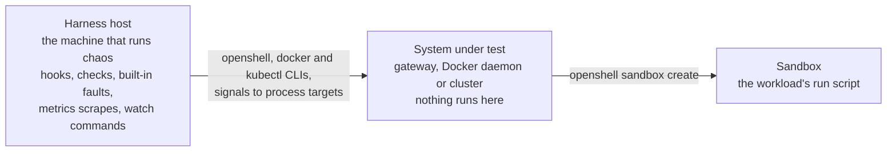

<!-- SPDX-FileCopyrightText: Copyright (c) 2025-2026 NVIDIA CORPORATION & AFFILIATES. All rights reserved. -->
<!-- SPDX-License-Identifier: Apache-2.0 -->

# Adapters

An adapter maps the harness onto one system on one backend: how to create an
instance, read its state, collect its files and delete it; which processes,
containers, workloads or pods the built-in faults can act on; which
operations experiments can use; and what to observe. `adapters/<id>.yaml`
holds one adapter. An experiment names the one it runs on with
`default-adapter: <id>`, and `--adapter <id>` runs it on another, so the same
experiment manifest runs on every adapter that has what it uses. Two adapters
exist: `adapters/openshell-docker.yaml`, OpenShell on the Docker compute
driver, and `adapters/openshell-kubernetes.yaml`, OpenShell on the Kubernetes
compute driver.

The harness knows nothing about OpenShell. Everything OpenShell-specific is in
the adapter's hooks.

- [Where things run](#where-things-run)
- [Fields](#fields)
- [Hooks](#hooks)
- [Instance hooks](#instance-hooks)
- [Targets](#targets)
- [Operations](#operations)
- [Observers](#observers)
- [openshell-docker](#openshell-docker)
- [openshell-kubernetes](#openshell-kubernetes)
- [Write an adapter](#write-an-adapter)

## Where things run

Code runs in three places.



- The harness host, the machine that runs `chaos`. Every adapter hook runs
  here as a host subprocess, `bash -c '<prelude>\n<script>' <name>`:
  `describe`, `setup`, the instance hooks, the operations, the targets'
  `start` and `after-recovery` hooks and `collect`. The checks, the adapter's preflight
  and adapter checks as well as the workload and experiment checks, and the
  `watch` commands run here too, as `bash -c '<script>'` without the prelude
  and without `CHAOS_EXPERIMENT_HOOK_TIMEOUT`. The built-in faults run here
  as well: the `docker` backend sends signals to the pids of process targets
  and runs the `docker` CLI for container targets, and the `kubernetes`
  backend runs `kubectl` against the adapter's `kubernetes.context`. The
  `metrics` scrapes are HTTP requests from here.
- The sandbox. Only the workload's `run` script runs here, as POSIX `sh`.
  The instance `create` hook passes it to `openshell sandbox create -- sh -c
  ...` inside a wrapper that records each attempt and the exit code.
- The system under test: the gateway, and the Docker daemon and its
  containers or the cluster and its pods. Nothing runs on it directly. The
  hooks reach it through the CLIs they call, `openshell`, `docker` and
  `kubectl`, and the built-in faults through signals to the process targets'
  pids, the `docker` CLI or `kubectl`.

So a hook can use anything installed on the harness host, and nothing it
writes reaches the sandbox except through the system's own CLI. A workload's
`run` script can use only what its image has.

## Fields

Every hook field runs on the harness host; see
[Where things run](#where-things-run).

| Field | Meaning |
|---|---|
| `apiVersion` | `chaos/v1alpha1`, the version of this language. Any other value is rejected. |
| `id` | Equals the file name without `.yaml`. |
| `limits` | What the system accepts from an experiment, in bytes: `env-value-bytes` for each `env` value of a workload or check, and `run-script-bytes` for a workload's `run`. An experiment over a limit is rejected against this adapter, before anything starts. |
| `describe` | Run hook that runs after preflight and prints one JSON object about the system under test: versions, image ids, the commit under test. The run records it verbatim as `environment.system` in `manifest.json`, the report shows it in the header, and `runs/index.jsonl` carries it. A failure, or output that is not a JSON object, ends the run with `ERROR`. |
| `backend` | What the built-in faults act through, from the harness host: `docker` or `kubernetes`. It decides which target types and faults the adapter supports; see [Targets](#targets). |
| `kubernetes` | For the `kubernetes` backend, required: `context`, the kubectl context every `kubectl` call names, never the current context. May use `${VAR}`. |
| `unavailable` | Why a built-in fault that the backend cannot provide is missing, by fault name. The reason is part of the message when an experiment that uses the fault is reported as not applicable on this adapter. |
| `requires-env` | Variables that must be set; `chaos run` exits 2 without them. |
| `preflight` | Checks that run before every experiment; see [Preflight](REFERENCE.md#preflight). |
| `prelude` | Bash that runs at the start of every hook: shared settings such as `set -euo pipefail`, and helper functions. |
| `options` | Workload options: `default`, and optional `enum`, `required: true`, or `data: true` (the value names an entry of the experiment's `data`). |
| `instance` | `output-dir` (the sandbox path) and the `create`, `status`, `collect` and `delete` hooks. |
| `setup` | Optional run hook that runs once before the flow. |
| `targets` | Named targets, such as `gateway`, and `roles` for `{workload, role}` targets. |
| `operations` | Each adapter operation's `run` hook and `options`, which take the same fields as workload options. An experiment can use only the operations its adapter has, and the built-in faults. |
| `collect` | Optional run hook that runs once after the flow, before the checks. |
| `metrics` | Prometheus endpoints to scrape: `name`, `url` (may use `${VAR}`) and `interval` (default `5s`). |
| `watch` | Commands to run beside the flow: `name` and `run`. Each stdout line is recorded. |
| `signals` | Events that `wait: {signal: ...}` can wait for: `name`, `watch` and `match`. |
| `checks` | Checks that apply to every experiment; `scope: adapter` in the verdict. |

The shape, with the hook scripts left out, as `openshell-docker.yaml` uses it:

```yaml
apiVersion: chaos/v1alpha1
id: openshell-docker
backend: docker
limits: {env-value-bytes: 8192, run-script-bytes: 28672}
requires-env: [OPENSHELL_BIN, OPENSHELL_GATEWAY, ...]
preflight:
  - {name: docker-reachable, description: ..., kind: shell, timeout: 30s, run: ...}
describe: |
  jq -n --arg openshell "$("$OPENSHELL_BIN" --version)" ... '{openshell: $openshell, ...}'
prelude: |
  set -euo pipefail
  ...
options:
  image: {default: ""}
  policy: {default: "", data: true}
  restart-policy: {default: never, enum: [never, on-failure, always]}
instance:
  output-dir: /sandbox/chaos-output
  create: ...
  status: ...
  collect: ...
  delete: ...
targets:
  gateway:
    type: process
    pid-file: ${OPENSHELL_E2E_GATEWAY_PID_FILE}
    start: ...
  roles:
    sandbox:
      type: container
      labels:
        openshell.ai/sandbox-id: ${CHAOS_EXPERIMENT_WORKLOAD_INSTANCE_SYSTEM_ID}
        openshell.ai/isolation-role: sandbox
operations:
  openshell-policy-set:
    options:
      policy: {data: true, required: true}
    run: ...
    revert: ...
  openshell-sandbox-restart:
    run: ...
    revert: none
    reason: ...
collect: ...
metrics:
  - {name: gateway, url: "http://127.0.0.1:${OPENSHELL_E2E_METRICS_PORT}/metrics", interval: 2s}
watch:
  - {name: docker-events, run: ...}
signals:
  - {name: reconcile-sweep, watch: otel, match: ...}
checks:
  - {name: no-leaked-containers, description: ..., kind: shell, run: ...}
```

## Hooks

A hook is a bash script written in the adapter. The harness runs it on the
host as `bash -c '<prelude>\n<script>' <name>`, so `$0` is the hook's name,
such as `instance.create`, `operations.openshell-policy-set`, `targets.gateway.start` or
`targets.gateway.after-recovery`. The run's `manifest.json` records the
adapter manifest's `sha256`, and the run directory keeps a copy as
`adapter.yaml`, so the record covers every script.

Every hook gets the process environment and `CHAOS_EXPERIMENT_HOOK_TIMEOUT`,
its timeout in whole seconds. The other variables depend on the hook; see
[Hook variables](REFERENCE.md#hook-variables). A hook that runs past its
timeout is killed with its process group. A hook that exits non-zero is a
harness error that ends the run with `ERROR`, with two exceptions: a failing
`status` reads as `Unknown`, and `collect` and `delete` are retried for 2
minutes before they count as failed; [Instance hooks](#instance-hooks) has
the details. The `delete` without collection that an abort runs, described
under [Signals](REFERENCE.md#signals), is best effort, and its exit status is
not reported.

## Instance hooks

- `create` starts the instance and prints its system id on the last line of
  stdout.
- `status` prints `Pending`, `Running`, `Succeeded`, `Failed` or `Unknown`.
  A failure reads as `Unknown`, so polling survives a gateway restart.
- `collect` copies the output dir to
  `$CHAOS_EXPERIMENT_WORKLOAD_INSTANCE_DIR/output` and logs to `logs/`.
- `delete` removes the instance and succeeds if it is already gone.

`collect` and `delete` are retried, for example across a gateway outage: a
failed attempt is tried again 2 seconds later until 2 minutes have passed
since the first attempt, and each attempt has the hook timeout of 5 minutes.
When an instance ends, the harness runs `collect`, then `delete`; a failed
`collect` still deletes.

## Targets

A target is what a built-in fault acts on.

On the `docker` backend:

- A `process` target has a `pid-file` and a `start` hook that brings the
  process back and rewrites the pid file. The harness records
  `target.restarted` when `start` returns.
- A `container` target selects running containers by `labels`. An empty label
  key or value is an error, so a selector never matches every container.

On the `kubernetes` backend:

- A `workload` target is a controller, named by `namespace` and `resource`,
  such as `statefulset/openshell`, whose pods the controller replaces. Its
  `start` hook waits until the replacement is ready and re-establishes
  whatever the run reaches it through, such as a port forward. The harness
  records `target.restarted` when `start` returns, and on the abort path it
  runs `start` for every workload target that has no ready pod.
- A `pod` target selects running pods by `namespace` and `labels`. An empty
  label key or value is an error here too.

Label values, `pid-file`, `namespace` and `resource` may use `${VAR}` from
the hook environment. `roles.<role>` are container or pod targets for each
instance of a workload: the experiment writes `target: {workload: counter,
role: sandbox}`, and the labels use
`${CHAOS_EXPERIMENT_WORKLOAD_INSTANCE_SYSTEM_ID}`.

A target can have an `after-recovery` run hook. It runs after `start`
returns, for checks or waits that must pass before the flow goes on. If it
fails, the run ends with `ERROR`.

Each backend supports these faults, by target type:

| Backend | Target type | Faults |
|---|---|---|
| `docker` | `process` | `restart`, `outage`, `freeze` |
| `docker` | `container` | `kill`, `restart-in-place`, `freeze` |
| `kubernetes` | `workload` | `restart`, `outage` |
| `kubernetes` | `pod` | `kill` |

[Built-in faults](REFERENCE.md#built-in-faults) says what each one does on
each target type. An adapter lists the faults its backend lacks under
`unavailable`, with the reason; an experiment that uses one is not applicable
on that adapter.

## Operations

An adapter operation is a hook that changes the system during the flow, such
as a new policy. It returns once the system reports the change in effect.

- It writes its outcome to `$CHAOS_EXPERIMENT_OPERATION_OUTCOME_FILE`: `ok`,
  `skipped` or `failed`, then an optional reason. A hook that writes nothing
  is a harness error. Use `failed` for a failure the experiment tests, such
  as a sandbox that does not start; the checks decide what it means.
- It exits non-zero only when it could not do its job. That is a harness
  error and ends the run with `ERROR`.
- Its stdout and stderr go to `logs/operations/<operation>.<instance>.log`, or
  `<operation>.log` for `scope: global`, with `--- run <n>` before each run
  and `--- revert run <n>` before each revert.
- It has a `revert` hook, or `revert: none` with a `reason` that says why
  there is nothing to put back. Each run of `run` has its own
  `$CHAOS_EXPERIMENT_OPERATION_STATE_DIR` to save what it replaces; `revert`
  runs with the same variables and reads it back. The harness reverts every
  run with outcome `ok` or `failed`, newest first, at the end of the flow and
  on abort, and skips a run whose instance is already deleted. A revert that
  exits non-zero is a harness error.

See [Adapter operations](REFERENCE.md#adapter-operations) for how the
experiment selects instances and what the timeline records.

## Observers

`metrics` sources and `watch` commands start with the flow and stop after the
adapter's `collect`. Each record has `t` on the timeline's clock.

- A metrics record in `system/metrics/<name>.jsonl` has `up: 1` and `samples`
  (`{series: value}`, with the series as exposed) when the endpoint answered
  with HTTP 200, else `up: 0` and `error`. A failed scrape is data: the
  gateway is expected to be down during some faults.
- A watch record in `system/watch/<name>.jsonl` has the stdout `line`. The
  command's stderr goes to `logs/watch-<name>.log`.

An observer that cannot start or fails adds an `observer.failed` timeline
event. It never changes the verdict.

A signal is a regex on the lines of one watch. Each matching line adds an
event and records `signal.received`. A `wait: {signal: ...}` node waits for
these events, so an experiment can time an operation relative to something
the system did:

```yaml
signals:
  - name: reconcile-sweep
    watch: otel
    match: 'Name\s+: reconcile\.sandboxes$'
```

## openshell-docker

`adapters/openshell-docker.yaml` runs OpenShell on the Docker compute driver
under `e2e/with-docker-gateway.sh`, which exports the `OPENSHELL_*` variables
it requires.

- Instances are sandboxes. `create` runs `openshell sandbox create --detach`
  with the wrapper; `output-dir` is `/sandbox/chaos-output`. Options: `image`,
  `policy` (data) and `restart-policy` (`never`, `on-failure` or `always`,
  default `never`).
- Targets: `gateway` (process) and the roles `sandbox` and `supervisor`
  (containers, by `openshell.ai/sandbox-id` and `openshell.ai/isolation-role`).
- `metrics` scrapes the gateway's `/metrics` every 2s as `gateway`.
- `watch` records `docker events` for the run's sandbox namespace as
  `docker-events`, and the gateway's trace spans as `otel`. That watch runs an
  OpenTelemetry Collector container that receives OTLP on
  `127.0.0.1:$OPENSHELL_E2E_OTLP_PORT` and prints each span with the debug
  exporter. When `OPENSHELL_E2E_GATEWAY_OTLP=1`, which the `e2e:chaos` tasks
  set, the e2e wrapper sets that port, points the gateway's
  `[openshell.gateway.otlp]` at it, and exports spans every 200ms
  (`OTEL_BSP_SCHEDULE_DELAY`).
- `signals` has `reconcile-sweep`: the end of each gateway reconcile sweep,
  when its `reconcile.sandboxes` span is exported. The next sweep starts 60s
  after that.
- `preflight` checks that Docker answers, the collector image and the
  OpenShell images are present, 5 GiB of disk is free, the CLI runs, `jq` is
  installed and the gateway is healthy.
- `checks`: `no-leaked-containers`, `nothing-paused` and `gateway-healthy`.
  `collect` waits 30s before it inspects containers.

Its operations:

- `openshell-policy-set` sets the policy that its `policy` option names (data,
  required). With a target it runs `openshell policy set <sandbox> --wait`.
  With `scope: global` it runs `openshell policy set --global`, then waits
  until each sandbox reports the global policy and logs a reload with its
  hash. Its `revert` puts back the policy that `run` saved: the sandbox's
  active policy, set again with `--wait`, or the global policy, set again or
  deleted when there was none. A reverted global policy does not wait for
  the sandboxes to reload it.
- `openshell-sandbox-restart` runs `openshell sandbox stop`, then `openshell sandbox
  start`, on each selected instance's sandbox. Its `jitter` option, in whole
  seconds from 0 to 30, makes each instance first wait a random time up to
  that long, so
  instances restarted together do not restart in step; the wait is not seeded
  by `--seed`. The outcome is `ok`, `skipped <phase>` for a sandbox that is
  not `Ready`, or `failed stop-failed <output>` or `failed start-failed
  <output>`. The hook exits 0 in all four cases.

## openshell-kubernetes

`adapters/openshell-kubernetes.yaml` runs OpenShell on the Kubernetes compute
driver under `e2e/with-kube-gateway.sh`, which installs the chart into the
cluster that `OPENSHELL_E2E_KUBE_CONTEXT` names, or into a local k3d cluster
when it is unset, and exports the `OPENSHELL_*` variables it requires.
`scripts/kubernetes-env.sh`, run between the wrapper and `chaos`, derives the
rest: the gateway resource, `statefulset/<release>` or
`deployment/<release>`, the gateway and metrics ports, and the directory for
the port-forward log. This adapter has not been run against a cluster yet:
it loads and validates, but no run directory from it exists.

```shell
OPENSHELL_E2E_KUBE_CONTEXT=kind-openshell-chaos e2e/with-kube-gateway.sh e2e/chaos/scripts/kubernetes-env.sh uv run --project e2e/chaos chaos run --adapter openshell-kubernetes e2e/chaos/experiments/gateway-graceful-restart.yaml
```

- `backend: kubernetes`, with `kubernetes.context` set to
  `${OPENSHELL_E2E_KUBE_CONTEXT}`.
- `unavailable` names `restart-in-place`, because the Kubernetes driver runs
  sandbox pods with `restartPolicy: Never`, so a container is never restarted
  in place, and `freeze`, because freezing a pod's processes needs node-level
  cgroup access through a privileged pod, which this adapter does not have.
  There is no `reconcile-sweep` signal, because the run has no OTLP
  collector. Experiments that need any of these are reported as not
  applicable; `chaos validate --all-adapters` lists them.
- Instances are sandboxes, created as on `openshell-docker`, with the same
  options; `collect` downloads the output with `openshell sandbox download`
  and falls back to `kubectl cp`, then saves each pod's logs.
- `setup` port-forwards the gateway; `forward_gateway` in the prelude does
  that and is run again by the gateway's `start` hook.
- Targets: `gateway` (workload, the gateway resource in
  `${OPENSHELL_E2E_KUBE_NAMESPACE}`, whose `start` hook waits for `kubectl
  rollout status` and re-establishes the port forward) and the roles
  `sandbox` and `supervisor` (pods in `${OPENSHELL_E2E_SANDBOX_NAMESPACE}`,
  by `openshell.ai/boundary-pair` and `openshell.ai/boundary-role`).
- `metrics` scrapes the gateway's `/metrics` through the port forward every
  2s as `gateway`.
- `watch` records the cluster's events, `kubectl get events --watch-only`,
  as `kube-events`.
- `preflight` checks that the cluster answers, the gateway resource exists,
  5 GiB of disk is free, the CLI runs, `jq` and `lsof` are installed and the
  gateway is healthy.
- `checks`: `no-leaked-pods` and `gateway-healthy`. `collect` waits 30s
  before it inspects pods, then saves the pod list and the health response
  under `system/`.
- Operations: `openshell-policy-set` and `openshell-sandbox-restart`, as on `openshell-docker`.

## Write an adapter

1. Copy `adapters/openshell-docker.yaml` or
   `adapters/openshell-kubernetes.yaml` to `adapters/<id>.yaml` and set `id`.
2. Write the instance hooks first, then `targets`, then `operations`. List
   under `unavailable` each built-in fault the backend lacks, with the
   reason.
3. Run `chaos validate --all-adapters`, which shows which experiments the
   adapter can run and lists what each other one needs that it lacks, then
   `chaos run --adapter <id> experiments/hello-world.yaml`.
4. Run `scripts/test-and-lint.sh`, which runs `shellcheck` on every hook with
   the prelude before it.

A backend other than `docker` or `kubernetes` needs code: an `Injector`
subclass in `src/chaos/inject/`, registered in `INJECTORS` in
`src/chaos/runner.py`, and its target types and faults in
`SUPPORTED_OPERATIONS` in `src/chaos/adapter.py`. The built-in faults act
through it.

## Provisioning

Not built. Preflight checks that the system under test exists; nothing in
the harness creates it. Today the creators are the wrappers outside the
adapter: `e2e/with-docker-gateway.sh` builds and starts the gateway, and
`e2e/with-kube-gateway.sh` installs the chart into an existing cluster or a
local k3d one. The intended shape is a `provision` and `deprovision` hook
pair on the adapter, run by `chaos provision <adapter>` and
`chaos deprovision <adapter>` and never by `chaos run`, with the
environment's parameters (cloud provider, region, node count and size,
chart version) on the adapter and only requirements on the experiment,
which preflight checks. For a cloud cluster the hooks would wrap Terraform
for the resources and the kube wrapper for the gateway, with Ansible only
where the adapter owns machines; `provision` prints what it made as JSON,
like `describe`, and `deprovision` reads it back.
