<!-- SPDX-FileCopyrightText: Copyright (c) 2025-2026 NVIDIA CORPORATION & AFFILIATES. All rights reserved. -->
<!-- SPDX-License-Identifier: Apache-2.0 -->

# Chaos experiments

`chaos` is a harness that runs declarative resilience and performance
experiments against a system that runs workloads.

- An **experiment** is one YAML file, the **experiment manifest**: the workloads for
  the system to run, each as one or more instances, the operations to apply
  while they run, a flow that orders them, and the checks that decide from
  recorded evidence whether the system did what the experiment claims. It
  says what, not how.
- An **operation** changes the state of the system while the workloads run. A
  **built-in fault**, such as `kill` or `outage`, disrupts one part of the
  system or one of its instances through the backend. An **adapter operation**,
  such as `openshell-policy-set`, runs a hook the adapter defines, which calls the
  system's own commands.
- An **adapter** is a second YAML file, the **adapter manifest**, that binds the
  harness to one system on one backend: what an instance is and the hooks
  that create, read, collect and delete one; the processes, containers,
  workloads or pods that the built-in faults act on; the adapter operations;
  and what to observe. The harness knows the system only through the
  adapter.
- `chaos run` takes one experiment and one adapter, creates the instances,
  applies the operations, reverts the faults it holds, records everything,
  cleans up, and writes one **experiment run**: a self-contained directory with
  every input, the timeline of what happened, logs, metrics, the files each
  instance wrote, and the verdict.
- From a run, `chaos report` draws an HTML report, `chaos share` writes a
  Markdown page with Mermaid charts to paste into an issue or a post,
  `chaos dashboard` builds the experiment's Grafana dashboard, and
  `chaos evaluate` decides the verdict again, offline, with changed checks.

OpenShell is the system the harness was built for; its instances are
sandboxes. Two adapters run it, `openshell-docker` on the Docker compute
driver and `openshell-kubernetes` on the Kubernetes compute driver, and an
experiment runs unchanged on either. Another system, or OpenShell on another
backend, is another adapter manifest, not a change to the harness.

Checks and hooks run as bash on the host with your permissions, and
operations act on the gateway and containers the e2e wrapper started:
`openshell-policy-set` changes the gateway's global policy and is reverted
at the end of the run, and the Kubernetes adapter kills only the
port-forward it started. Review an experiment before you run it.

```mermaid
%%{init: {"flowchart": {"wrappingWidth": 600}, "themeVariables": {"fontSize": "20px"}}}%%
flowchart LR
  subgraph experiment ["experiment manifest"]
    e["<pre>id:#nbsp;supervisor-kill#nbsp;#nbsp;#nbsp;#nbsp;#nbsp;#nbsp;#nbsp;#nbsp;#nbsp;#nbsp;#nbsp;#nbsp;#nbsp;#nbsp;#nbsp;#nbsp;#nbsp;#nbsp;#nbsp;#nbsp;#nbsp;#nbsp;#nbsp;#nbsp;#nbsp;#nbsp;#nbsp;#nbsp;#nbsp;#nbsp;#nbsp;#nbsp;#nbsp;#nbsp;#nbsp;#nbsp;#nbsp;#nbsp;#nbsp;#nbsp;<br/>default-adapter:#nbsp;openshell-docker#nbsp;#nbsp;#nbsp;#nbsp;#nbsp;#nbsp;#nbsp;#nbsp;#nbsp;#nbsp;#nbsp;#nbsp;#nbsp;#nbsp;#nbsp;#nbsp;#nbsp;#nbsp;#nbsp;#nbsp;#nbsp;#nbsp;#nbsp;#nbsp;#nbsp;#nbsp;<br/>workloads:#nbsp;#nbsp;#nbsp;#nbsp;#nbsp;#nbsp;#nbsp;#nbsp;#nbsp;#nbsp;#nbsp;#nbsp;#nbsp;#nbsp;#nbsp;#nbsp;#nbsp;#nbsp;#nbsp;#nbsp;#nbsp;#nbsp;#nbsp;#nbsp;#nbsp;#nbsp;#nbsp;#nbsp;#nbsp;#nbsp;#nbsp;#nbsp;#nbsp;#nbsp;#nbsp;#nbsp;#nbsp;#nbsp;#nbsp;#nbsp;#nbsp;#nbsp;#nbsp;#nbsp;#nbsp;#nbsp;#nbsp;#nbsp;#nbsp;<br/>#nbsp;#nbsp;-#nbsp;name:#nbsp;counter#nbsp;#nbsp;#nbsp;#nbsp;#nbsp;#nbsp;#nbsp;#nbsp;#nbsp;#nbsp;#nbsp;#nbsp;#nbsp;#nbsp;#nbsp;#nbsp;#nbsp;#nbsp;#nbsp;#nbsp;#nbsp;#nbsp;#nbsp;#nbsp;#nbsp;#nbsp;#nbsp;#nbsp;#nbsp;#nbsp;#nbsp;#nbsp;#nbsp;#nbsp;#nbsp;#nbsp;#nbsp;#nbsp;#nbsp;#nbsp;#nbsp;#nbsp;<br/>#nbsp;#nbsp;#nbsp;#nbsp;kind:#nbsp;shell#nbsp;#nbsp;#nbsp;#nbsp;#nbsp;#nbsp;#nbsp;#nbsp;#nbsp;#nbsp;#nbsp;#nbsp;#nbsp;#nbsp;#nbsp;#nbsp;#nbsp;#nbsp;#nbsp;#nbsp;#nbsp;#nbsp;#nbsp;#nbsp;#nbsp;#nbsp;#nbsp;#nbsp;#nbsp;#nbsp;#nbsp;#nbsp;#nbsp;#nbsp;#nbsp;#nbsp;#nbsp;#nbsp;#nbsp;#nbsp;#nbsp;#nbsp;#nbsp;#nbsp;<br/>#nbsp;#nbsp;#nbsp;#nbsp;instances:#nbsp;3#nbsp;#nbsp;#nbsp;#nbsp;#nbsp;#nbsp;#nbsp;#nbsp;#nbsp;#nbsp;#nbsp;#nbsp;#nbsp;#nbsp;#nbsp;#nbsp;#nbsp;#nbsp;#nbsp;#nbsp;#nbsp;#nbsp;#nbsp;#nbsp;#nbsp;#nbsp;#nbsp;#nbsp;#nbsp;#nbsp;#nbsp;#nbsp;#nbsp;#nbsp;#nbsp;#nbsp;#nbsp;#nbsp;#nbsp;#nbsp;#nbsp;#nbsp;#nbsp;<br/>#nbsp;#nbsp;#nbsp;#nbsp;run:#nbsp;|#nbsp;#nbsp;#nbsp;#nbsp;#nbsp;#nbsp;#nbsp;#nbsp;#nbsp;#nbsp;#nbsp;#nbsp;#nbsp;#nbsp;#nbsp;#nbsp;#nbsp;#nbsp;#nbsp;#nbsp;#nbsp;#nbsp;#nbsp;#nbsp;#nbsp;#nbsp;#nbsp;#nbsp;#nbsp;#nbsp;#nbsp;#nbsp;#nbsp;#nbsp;#nbsp;#nbsp;#nbsp;#nbsp;#nbsp;#nbsp;#nbsp;#nbsp;#nbsp;#nbsp;#nbsp;#nbsp;#nbsp;#nbsp;#nbsp;<br/>#nbsp;#nbsp;#nbsp;#nbsp;#nbsp;#nbsp;for#nbsp;i#nbsp;in#nbsp;$(seq#nbsp;1#nbsp;#quot;$TICKS#quot;);#nbsp;do#nbsp;...#nbsp;#nbsp;#nbsp;#nbsp;#nbsp;#nbsp;#nbsp;#nbsp;#nbsp;#nbsp;#nbsp;#nbsp;#nbsp;#nbsp;#nbsp;#nbsp;#nbsp;#nbsp;#nbsp;<br/>#nbsp;#nbsp;#nbsp;#nbsp;checks:#nbsp;#nbsp;#nbsp;#nbsp;#nbsp;#nbsp;#nbsp;#nbsp;#nbsp;#nbsp;#nbsp;#nbsp;#nbsp;#nbsp;#nbsp;#nbsp;#nbsp;#nbsp;#nbsp;#nbsp;#nbsp;#nbsp;#nbsp;#nbsp;#nbsp;#nbsp;#nbsp;#nbsp;#nbsp;#nbsp;#nbsp;#nbsp;#nbsp;#nbsp;#nbsp;#nbsp;#nbsp;#nbsp;#nbsp;#nbsp;#nbsp;#nbsp;#nbsp;#nbsp;#nbsp;#nbsp;#nbsp;#nbsp;<br/>#nbsp;#nbsp;#nbsp;#nbsp;#nbsp;#nbsp;-#nbsp;name:#nbsp;exited-ok#nbsp;#nbsp;#nbsp;#nbsp;#nbsp;#nbsp;#nbsp;#nbsp;#nbsp;#nbsp;#nbsp;#nbsp;#nbsp;#nbsp;#nbsp;#nbsp;#nbsp;#nbsp;#nbsp;#nbsp;#nbsp;#nbsp;#nbsp;#nbsp;#nbsp;#nbsp;#nbsp;#nbsp;#nbsp;#nbsp;#nbsp;#nbsp;#nbsp;#nbsp;#nbsp;#nbsp;<br/>#nbsp;#nbsp;#nbsp;#nbsp;#nbsp;#nbsp;#nbsp;#nbsp;kind:#nbsp;exit-code#nbsp;#nbsp;#nbsp;#nbsp;#nbsp;#nbsp;#nbsp;#nbsp;#nbsp;#nbsp;#nbsp;#nbsp;#nbsp;#nbsp;#nbsp;#nbsp;#nbsp;#nbsp;#nbsp;#nbsp;#nbsp;#nbsp;#nbsp;#nbsp;#nbsp;#nbsp;#nbsp;#nbsp;#nbsp;#nbsp;#nbsp;#nbsp;#nbsp;#nbsp;#nbsp;#nbsp;<br/>#nbsp;#nbsp;#nbsp;#nbsp;#nbsp;#nbsp;#nbsp;#nbsp;equals:#nbsp;0#nbsp;#nbsp;#nbsp;#nbsp;#nbsp;#nbsp;#nbsp;#nbsp;#nbsp;#nbsp;#nbsp;#nbsp;#nbsp;#nbsp;#nbsp;#nbsp;#nbsp;#nbsp;#nbsp;#nbsp;#nbsp;#nbsp;#nbsp;#nbsp;#nbsp;#nbsp;#nbsp;#nbsp;#nbsp;#nbsp;#nbsp;#nbsp;#nbsp;#nbsp;#nbsp;#nbsp;#nbsp;#nbsp;#nbsp;#nbsp;#nbsp;#nbsp;<br/>operations:#nbsp;#nbsp;#nbsp;#nbsp;#nbsp;#nbsp;#nbsp;#nbsp;#nbsp;#nbsp;#nbsp;#nbsp;#nbsp;#nbsp;#nbsp;#nbsp;#nbsp;#nbsp;#nbsp;#nbsp;#nbsp;#nbsp;#nbsp;#nbsp;#nbsp;#nbsp;#nbsp;#nbsp;#nbsp;#nbsp;#nbsp;#nbsp;#nbsp;#nbsp;#nbsp;#nbsp;#nbsp;#nbsp;#nbsp;#nbsp;#nbsp;#nbsp;#nbsp;#nbsp;#nbsp;#nbsp;#nbsp;#nbsp;<br/>#nbsp;#nbsp;-#nbsp;name:#nbsp;kill-supervisors#nbsp;#nbsp;#nbsp;#nbsp;#nbsp;#nbsp;#nbsp;#nbsp;#nbsp;#nbsp;#nbsp;#nbsp;#nbsp;#nbsp;#nbsp;#nbsp;#nbsp;#nbsp;#nbsp;#nbsp;#nbsp;#nbsp;#nbsp;#nbsp;#nbsp;#nbsp;#nbsp;#nbsp;#nbsp;#nbsp;#nbsp;#nbsp;#nbsp;<br/>#nbsp;#nbsp;#nbsp;#nbsp;uses:#nbsp;kill#nbsp;#nbsp;#nbsp;#nbsp;#nbsp;#nbsp;#nbsp;#nbsp;#nbsp;#nbsp;#nbsp;#nbsp;#nbsp;#nbsp;#nbsp;#nbsp;#nbsp;#nbsp;#nbsp;#nbsp;#nbsp;#nbsp;#nbsp;#nbsp;#nbsp;#nbsp;#nbsp;#nbsp;#nbsp;#nbsp;#nbsp;#nbsp;#nbsp;#nbsp;#nbsp;#nbsp;#nbsp;#nbsp;#nbsp;#nbsp;#nbsp;#nbsp;#nbsp;#nbsp;#nbsp;<br/>#nbsp;#nbsp;#nbsp;#nbsp;target:#nbsp;{workload:#nbsp;counter,#nbsp;role:#nbsp;supervisor}#nbsp;#nbsp;#nbsp;#nbsp;#nbsp;#nbsp;#nbsp;#nbsp;#nbsp;#nbsp;<br/>#nbsp;#nbsp;#nbsp;#nbsp;select:#nbsp;{count:#nbsp;2}#nbsp;#nbsp;#nbsp;#nbsp;#nbsp;#nbsp;#nbsp;#nbsp;#nbsp;#nbsp;#nbsp;#nbsp;#nbsp;#nbsp;#nbsp;#nbsp;#nbsp;#nbsp;#nbsp;#nbsp;#nbsp;#nbsp;#nbsp;#nbsp;#nbsp;#nbsp;#nbsp;#nbsp;#nbsp;#nbsp;#nbsp;#nbsp;#nbsp;#nbsp;#nbsp;#nbsp;#nbsp;<br/>flow:#nbsp;#nbsp;#nbsp;#nbsp;#nbsp;#nbsp;#nbsp;#nbsp;#nbsp;#nbsp;#nbsp;#nbsp;#nbsp;#nbsp;#nbsp;#nbsp;#nbsp;#nbsp;#nbsp;#nbsp;#nbsp;#nbsp;#nbsp;#nbsp;#nbsp;#nbsp;#nbsp;#nbsp;#nbsp;#nbsp;#nbsp;#nbsp;#nbsp;#nbsp;#nbsp;#nbsp;#nbsp;#nbsp;#nbsp;#nbsp;#nbsp;#nbsp;#nbsp;#nbsp;#nbsp;#nbsp;#nbsp;#nbsp;#nbsp;#nbsp;#nbsp;#nbsp;#nbsp;#nbsp;<br/>#nbsp;#nbsp;parallel:#nbsp;#nbsp;#nbsp;#nbsp;#nbsp;#nbsp;#nbsp;#nbsp;#nbsp;#nbsp;#nbsp;#nbsp;#nbsp;#nbsp;#nbsp;#nbsp;#nbsp;#nbsp;#nbsp;#nbsp;#nbsp;#nbsp;#nbsp;#nbsp;#nbsp;#nbsp;#nbsp;#nbsp;#nbsp;#nbsp;#nbsp;#nbsp;#nbsp;#nbsp;#nbsp;#nbsp;#nbsp;#nbsp;#nbsp;#nbsp;#nbsp;#nbsp;#nbsp;#nbsp;#nbsp;#nbsp;#nbsp;#nbsp;<br/>#nbsp;#nbsp;#nbsp;#nbsp;-#nbsp;counter#nbsp;#nbsp;#nbsp;#nbsp;#nbsp;#nbsp;#nbsp;#nbsp;#nbsp;#nbsp;#nbsp;#nbsp;#nbsp;#nbsp;#nbsp;#nbsp;#nbsp;#nbsp;#nbsp;#nbsp;#nbsp;#nbsp;#nbsp;#nbsp;#nbsp;#nbsp;#nbsp;#nbsp;#nbsp;#nbsp;#nbsp;#nbsp;#nbsp;#nbsp;#nbsp;#nbsp;#nbsp;#nbsp;#nbsp;#nbsp;#nbsp;#nbsp;#nbsp;#nbsp;#nbsp;#nbsp;<br/>#nbsp;#nbsp;#nbsp;#nbsp;-#nbsp;serial:#nbsp;[{wait:#nbsp;...},#nbsp;{delay:#nbsp;10s},#nbsp;kill-supervisors]</pre>"]
  end
  subgraph adapter ["adapter manifest"]
    a["<pre>id:#nbsp;openshell-docker#nbsp;#nbsp;#nbsp;#nbsp;#nbsp;#nbsp;#nbsp;#nbsp;#nbsp;#nbsp;#nbsp;#nbsp;#nbsp;#nbsp;#nbsp;#nbsp;#nbsp;#nbsp;#nbsp;#nbsp;#nbsp;#nbsp;#nbsp;#nbsp;#nbsp;#nbsp;#nbsp;#nbsp;#nbsp;#nbsp;#nbsp;#nbsp;#nbsp;#nbsp;#nbsp;#nbsp;#nbsp;#nbsp;#nbsp;#nbsp;#nbsp;<br/>backend:#nbsp;docker#nbsp;#nbsp;#nbsp;#nbsp;#nbsp;#nbsp;#nbsp;#nbsp;#nbsp;#nbsp;#nbsp;#nbsp;#nbsp;#nbsp;#nbsp;#nbsp;#nbsp;#nbsp;#nbsp;#nbsp;#nbsp;#nbsp;#nbsp;#nbsp;#nbsp;#nbsp;#nbsp;#nbsp;#nbsp;#nbsp;#nbsp;#nbsp;#nbsp;#nbsp;#nbsp;#nbsp;#nbsp;#nbsp;#nbsp;#nbsp;#nbsp;#nbsp;#nbsp;#nbsp;#nbsp;#nbsp;<br/>instance:#nbsp;#nbsp;#nbsp;#nbsp;#nbsp;#nbsp;#nbsp;#nbsp;#nbsp;#nbsp;#nbsp;#nbsp;#nbsp;#nbsp;#nbsp;#nbsp;#nbsp;#nbsp;#nbsp;#nbsp;#nbsp;#nbsp;#nbsp;#nbsp;#nbsp;#nbsp;#nbsp;#nbsp;#nbsp;#nbsp;#nbsp;#nbsp;#nbsp;#nbsp;#nbsp;#nbsp;#nbsp;#nbsp;#nbsp;#nbsp;#nbsp;#nbsp;#nbsp;#nbsp;#nbsp;#nbsp;#nbsp;#nbsp;#nbsp;#nbsp;#nbsp;#nbsp;<br/>#nbsp;#nbsp;create:#nbsp;|#nbsp;#nbsp;#nbsp;#nbsp;#nbsp;#nbsp;#nbsp;#nbsp;#nbsp;#nbsp;#nbsp;#nbsp;#nbsp;#nbsp;#nbsp;#nbsp;#nbsp;#nbsp;#nbsp;#nbsp;#nbsp;#nbsp;#nbsp;#nbsp;#nbsp;#nbsp;#nbsp;#nbsp;#nbsp;#nbsp;#nbsp;#nbsp;#nbsp;#nbsp;#nbsp;#nbsp;#nbsp;#nbsp;#nbsp;#nbsp;#nbsp;#nbsp;#nbsp;#nbsp;#nbsp;#nbsp;#nbsp;#nbsp;#nbsp;#nbsp;<br/>#nbsp;#nbsp;#nbsp;#nbsp;openshell#nbsp;sandbox#nbsp;create#nbsp;...#nbsp;#nbsp;#nbsp;#nbsp;#nbsp;#nbsp;#nbsp;#nbsp;#nbsp;#nbsp;#nbsp;#nbsp;#nbsp;#nbsp;#nbsp;#nbsp;#nbsp;#nbsp;#nbsp;#nbsp;#nbsp;#nbsp;#nbsp;#nbsp;#nbsp;#nbsp;#nbsp;#nbsp;#nbsp;<br/>#nbsp;#nbsp;collect:#nbsp;|#nbsp;#nbsp;#nbsp;#nbsp;#nbsp;#nbsp;#nbsp;#nbsp;#nbsp;#nbsp;#nbsp;#nbsp;#nbsp;#nbsp;#nbsp;#nbsp;#nbsp;#nbsp;#nbsp;#nbsp;#nbsp;#nbsp;#nbsp;#nbsp;#nbsp;#nbsp;#nbsp;#nbsp;#nbsp;#nbsp;#nbsp;#nbsp;#nbsp;#nbsp;#nbsp;#nbsp;#nbsp;#nbsp;#nbsp;#nbsp;#nbsp;#nbsp;#nbsp;#nbsp;#nbsp;#nbsp;#nbsp;#nbsp;#nbsp;<br/>#nbsp;#nbsp;#nbsp;#nbsp;openshell#nbsp;sandbox#nbsp;download#nbsp;...#nbsp;#nbsp;#nbsp;#nbsp;#nbsp;#nbsp;#nbsp;#nbsp;#nbsp;#nbsp;#nbsp;#nbsp;#nbsp;#nbsp;#nbsp;#nbsp;#nbsp;#nbsp;#nbsp;#nbsp;#nbsp;#nbsp;#nbsp;#nbsp;#nbsp;#nbsp;#nbsp;<br/>targets:#nbsp;#nbsp;#nbsp;#nbsp;#nbsp;#nbsp;#nbsp;#nbsp;#nbsp;#nbsp;#nbsp;#nbsp;#nbsp;#nbsp;#nbsp;#nbsp;#nbsp;#nbsp;#nbsp;#nbsp;#nbsp;#nbsp;#nbsp;#nbsp;#nbsp;#nbsp;#nbsp;#nbsp;#nbsp;#nbsp;#nbsp;#nbsp;#nbsp;#nbsp;#nbsp;#nbsp;#nbsp;#nbsp;#nbsp;#nbsp;#nbsp;#nbsp;#nbsp;#nbsp;#nbsp;#nbsp;#nbsp;#nbsp;#nbsp;#nbsp;#nbsp;#nbsp;#nbsp;<br/>#nbsp;#nbsp;gateway:#nbsp;{type:#nbsp;process,#nbsp;pid-file:#nbsp;...}#nbsp;#nbsp;#nbsp;#nbsp;#nbsp;#nbsp;#nbsp;#nbsp;#nbsp;#nbsp;#nbsp;#nbsp;#nbsp;#nbsp;#nbsp;#nbsp;#nbsp;#nbsp;#nbsp;#nbsp;<br/>#nbsp;#nbsp;roles:#nbsp;#nbsp;#nbsp;#nbsp;#nbsp;#nbsp;#nbsp;#nbsp;#nbsp;#nbsp;#nbsp;#nbsp;#nbsp;#nbsp;#nbsp;#nbsp;#nbsp;#nbsp;#nbsp;#nbsp;#nbsp;#nbsp;#nbsp;#nbsp;#nbsp;#nbsp;#nbsp;#nbsp;#nbsp;#nbsp;#nbsp;#nbsp;#nbsp;#nbsp;#nbsp;#nbsp;#nbsp;#nbsp;#nbsp;#nbsp;#nbsp;#nbsp;#nbsp;#nbsp;#nbsp;#nbsp;#nbsp;#nbsp;#nbsp;#nbsp;#nbsp;#nbsp;#nbsp;<br/>#nbsp;#nbsp;#nbsp;#nbsp;sandbox:#nbsp;{type:#nbsp;container,#nbsp;labels:#nbsp;...}#nbsp;#nbsp;#nbsp;#nbsp;#nbsp;#nbsp;#nbsp;#nbsp;#nbsp;#nbsp;#nbsp;#nbsp;#nbsp;#nbsp;#nbsp;#nbsp;#nbsp;#nbsp;<br/>#nbsp;#nbsp;#nbsp;#nbsp;supervisor:#nbsp;{type:#nbsp;container,#nbsp;labels:#nbsp;...}#nbsp;#nbsp;#nbsp;#nbsp;#nbsp;#nbsp;#nbsp;#nbsp;#nbsp;#nbsp;#nbsp;#nbsp;#nbsp;#nbsp;#nbsp;<br/>operations:#nbsp;#nbsp;#nbsp;#nbsp;#nbsp;#nbsp;#nbsp;#nbsp;#nbsp;#nbsp;#nbsp;#nbsp;#nbsp;#nbsp;#nbsp;#nbsp;#nbsp;#nbsp;#nbsp;#nbsp;#nbsp;#nbsp;#nbsp;#nbsp;#nbsp;#nbsp;#nbsp;#nbsp;#nbsp;#nbsp;#nbsp;#nbsp;#nbsp;#nbsp;#nbsp;#nbsp;#nbsp;#nbsp;#nbsp;#nbsp;#nbsp;#nbsp;#nbsp;#nbsp;#nbsp;#nbsp;#nbsp;#nbsp;#nbsp;#nbsp;<br/>#nbsp;#nbsp;openshell-policy-set:#nbsp;#nbsp;#nbsp;#nbsp;#nbsp;#nbsp;#nbsp;#nbsp;#nbsp;#nbsp;#nbsp;#nbsp;#nbsp;#nbsp;#nbsp;#nbsp;#nbsp;#nbsp;#nbsp;#nbsp;#nbsp;#nbsp;#nbsp;#nbsp;#nbsp;#nbsp;#nbsp;#nbsp;#nbsp;#nbsp;#nbsp;#nbsp;#nbsp;#nbsp;#nbsp;#nbsp;#nbsp;#nbsp;<br/>#nbsp;#nbsp;#nbsp;#nbsp;run:#nbsp;|#nbsp;#nbsp;#nbsp;#nbsp;#nbsp;#nbsp;#nbsp;#nbsp;#nbsp;#nbsp;#nbsp;#nbsp;#nbsp;#nbsp;#nbsp;#nbsp;#nbsp;#nbsp;#nbsp;#nbsp;#nbsp;#nbsp;#nbsp;#nbsp;#nbsp;#nbsp;#nbsp;#nbsp;#nbsp;#nbsp;#nbsp;#nbsp;#nbsp;#nbsp;#nbsp;#nbsp;#nbsp;#nbsp;#nbsp;#nbsp;#nbsp;#nbsp;#nbsp;#nbsp;#nbsp;#nbsp;#nbsp;#nbsp;#nbsp;#nbsp;#nbsp;<br/>#nbsp;#nbsp;#nbsp;#nbsp;#nbsp;#nbsp;openshell#nbsp;policy#nbsp;set#nbsp;#quot;$(sandbox_name)#quot;#nbsp;--policy#nbsp;...#nbsp;#nbsp;#nbsp;#nbsp;<br/>metrics:#nbsp;#nbsp;#nbsp;#nbsp;#nbsp;#nbsp;#nbsp;#nbsp;#nbsp;#nbsp;#nbsp;#nbsp;#nbsp;#nbsp;#nbsp;#nbsp;#nbsp;#nbsp;#nbsp;#nbsp;#nbsp;#nbsp;#nbsp;#nbsp;#nbsp;#nbsp;#nbsp;#nbsp;#nbsp;#nbsp;#nbsp;#nbsp;#nbsp;#nbsp;#nbsp;#nbsp;#nbsp;#nbsp;#nbsp;#nbsp;#nbsp;#nbsp;#nbsp;#nbsp;#nbsp;#nbsp;#nbsp;#nbsp;#nbsp;#nbsp;#nbsp;#nbsp;#nbsp;<br/>#nbsp;#nbsp;-#nbsp;{name:#nbsp;gateway,#nbsp;url:#nbsp;http://127.0.0.1:.../metrics}#nbsp;#nbsp;#nbsp;#nbsp;#nbsp;#nbsp;#nbsp;<br/>watch:#nbsp;#nbsp;#nbsp;#nbsp;#nbsp;#nbsp;#nbsp;#nbsp;#nbsp;#nbsp;#nbsp;#nbsp;#nbsp;#nbsp;#nbsp;#nbsp;#nbsp;#nbsp;#nbsp;#nbsp;#nbsp;#nbsp;#nbsp;#nbsp;#nbsp;#nbsp;#nbsp;#nbsp;#nbsp;#nbsp;#nbsp;#nbsp;#nbsp;#nbsp;#nbsp;#nbsp;#nbsp;#nbsp;#nbsp;#nbsp;#nbsp;#nbsp;#nbsp;#nbsp;#nbsp;#nbsp;#nbsp;#nbsp;#nbsp;#nbsp;#nbsp;#nbsp;#nbsp;#nbsp;#nbsp;<br/>#nbsp;#nbsp;-#nbsp;{name:#nbsp;docker-events,#nbsp;run:#nbsp;docker#nbsp;events#nbsp;...}#nbsp;#nbsp;#nbsp;#nbsp;#nbsp;#nbsp;#nbsp;#nbsp;#nbsp;#nbsp;#nbsp;#nbsp;<br/>#nbsp;#nbsp;-#nbsp;{name:#nbsp;otel,#nbsp;run:#nbsp;docker#nbsp;run#nbsp;...#nbsp;opentelemetry-collector}</pre>"]
  end
  experiment -- "the argument" --> chaos["<pre>chaos#nbsp;run#nbsp;experiments/supervisor-kill.yaml</pre>"]
  adapter -- "named by default-adapter,<br/>or by --adapter ID" --> chaos
  subgraph ops ["what runs against the system"]
    direction TB
    h["adapter hooks<br/><pre>openshell#nbsp;sandbox#nbsp;create#nbsp;#nbsp;<br/>openshell#nbsp;sandbox#nbsp;download<br/>openshell#nbsp;policy#nbsp;set#nbsp;#nbsp;#nbsp;#nbsp;#nbsp;#nbsp;</pre>"]
    f["built-in faults<br/><pre>kill#nbsp;-TERM,#nbsp;kill#nbsp;-STOP#nbsp;#nbsp;#nbsp;<br/>docker#nbsp;kill,#nbsp;docker#nbsp;pause</pre>"]
    o["observers<br/><pre>GET#nbsp;/metrics#nbsp;#nbsp;#nbsp;#nbsp;#nbsp;#nbsp;#nbsp;#nbsp;#nbsp;#nbsp;#nbsp;#nbsp;#nbsp;#nbsp;#nbsp;<br/>docker#nbsp;events#nbsp;#nbsp;#nbsp;#nbsp;#nbsp;#nbsp;#nbsp;#nbsp;#nbsp;#nbsp;#nbsp;#nbsp;#nbsp;#nbsp;<br/>OTLP#nbsp;spans#nbsp;from#nbsp;the#nbsp;gateway</pre>"]
  end
  chaos --> ops
  ops <--> sut
  subgraph sut ["system under test"]
    direction TB
    gw["OpenShell gateway process<br/>on the Docker backend"]
    subgraph inst ["per instance"]
      direction LR
      sb["sandbox container"] --- sv["supervisor container"]
    end
    gw --- inst
  end
  chaos -- "creates" --> run
  subgraph run ["experiment run, one directory"]
    r["<pre>runs/#lt;experiment#gt;/#lt;run#nbsp;id#gt;/#nbsp;#nbsp;#nbsp;#nbsp;#nbsp;<br/>├──#nbsp;experiment.yaml#nbsp;#nbsp;#nbsp;#nbsp;#nbsp;#nbsp;#nbsp;#nbsp;#nbsp;#nbsp;#nbsp;#nbsp;#nbsp;<br/>├──#nbsp;adapter.yaml#nbsp;#nbsp;#nbsp;#nbsp;#nbsp;#nbsp;#nbsp;#nbsp;#nbsp;#nbsp;#nbsp;#nbsp;#nbsp;#nbsp;#nbsp;#nbsp;<br/>├──#nbsp;manifest.json#nbsp;#nbsp;#nbsp;#nbsp;#nbsp;#nbsp;#nbsp;#nbsp;#nbsp;#nbsp;#nbsp;#nbsp;#nbsp;#nbsp;#nbsp;<br/>├──#nbsp;timeline.jsonl#nbsp;#nbsp;#nbsp;#nbsp;#nbsp;#nbsp;#nbsp;#nbsp;#nbsp;#nbsp;#nbsp;#nbsp;#nbsp;#nbsp;<br/>├──#nbsp;verdict.json#nbsp;#nbsp;#nbsp;#nbsp;#nbsp;#nbsp;#nbsp;#nbsp;#nbsp;#nbsp;#nbsp;#nbsp;#nbsp;#nbsp;#nbsp;#nbsp;<br/>├──#nbsp;report.html#nbsp;#nbsp;#nbsp;#nbsp;#nbsp;#nbsp;#nbsp;#nbsp;#nbsp;#nbsp;#nbsp;#nbsp;#nbsp;#nbsp;#nbsp;#nbsp;#nbsp;<br/>├──#nbsp;logs/#nbsp;#nbsp;#nbsp;#nbsp;#nbsp;#nbsp;#nbsp;#nbsp;#nbsp;#nbsp;#nbsp;#nbsp;#nbsp;#nbsp;#nbsp;#nbsp;#nbsp;#nbsp;#nbsp;#nbsp;#nbsp;#nbsp;#nbsp;<br/>│#nbsp;#nbsp;#nbsp;├──#nbsp;harness.log#nbsp;#nbsp;#nbsp;#nbsp;#nbsp;#nbsp;#nbsp;#nbsp;#nbsp;#nbsp;#nbsp;#nbsp;#nbsp;<br/>│#nbsp;#nbsp;#nbsp;└──#nbsp;gateway.log#nbsp;#nbsp;#nbsp;#nbsp;#nbsp;#nbsp;#nbsp;#nbsp;#nbsp;#nbsp;#nbsp;#nbsp;#nbsp;<br/>├──#nbsp;system/#nbsp;#nbsp;#nbsp;#nbsp;#nbsp;#nbsp;#nbsp;#nbsp;#nbsp;#nbsp;#nbsp;#nbsp;#nbsp;#nbsp;#nbsp;#nbsp;#nbsp;#nbsp;#nbsp;#nbsp;#nbsp;<br/>│#nbsp;#nbsp;#nbsp;├──#nbsp;metrics/gateway.jsonl#nbsp;#nbsp;#nbsp;<br/>│#nbsp;#nbsp;#nbsp;└──#nbsp;watch/#nbsp;#nbsp;#nbsp;#nbsp;#nbsp;#nbsp;#nbsp;#nbsp;#nbsp;#nbsp;#nbsp;#nbsp;#nbsp;#nbsp;#nbsp;#nbsp;#nbsp;#nbsp;<br/>│#nbsp;#nbsp;#nbsp;#nbsp;#nbsp;#nbsp;#nbsp;├──#nbsp;docker-events.jsonl#nbsp;<br/>│#nbsp;#nbsp;#nbsp;#nbsp;#nbsp;#nbsp;#nbsp;└──#nbsp;otel.jsonl#nbsp;#nbsp;#nbsp;#nbsp;#nbsp;#nbsp;#nbsp;#nbsp;#nbsp;#nbsp;<br/>└──#nbsp;workloads/counter/instances/<br/>#nbsp;#nbsp;#nbsp;#nbsp;└──#nbsp;counter-0/#nbsp;#nbsp;#nbsp;#nbsp;#nbsp;#nbsp;#nbsp;#nbsp;#nbsp;#nbsp;#nbsp;#nbsp;#nbsp;#nbsp;<br/>#nbsp;#nbsp;#nbsp;#nbsp;#nbsp;#nbsp;#nbsp;#nbsp;├──#nbsp;logs/sandbox.log#nbsp;#nbsp;#nbsp;#nbsp;<br/>#nbsp;#nbsp;#nbsp;#nbsp;#nbsp;#nbsp;#nbsp;#nbsp;├──#nbsp;logs/supervisor.log#nbsp;<br/>#nbsp;#nbsp;#nbsp;#nbsp;#nbsp;#nbsp;#nbsp;#nbsp;└──#nbsp;output/journal#nbsp;#nbsp;#nbsp;#nbsp;#nbsp;#nbsp;</pre>"]
  end
```

The system under test is whatever the adapter manifest binds the harness to.
In the diagram it is OpenShell on the Docker backend: the gateway, a process
on the host, and for each instance a sandbox container and a supervisor
container, which `openshell-docker` creates with `openshell sandbox create`
and the built-in faults reach with signals and `docker`. On
`openshell-kubernetes` it is OpenShell on a cluster: the gateway is a
workload resource that `kubectl scale` can scale, each instance is a sandbox
pod and a supervisor pod, and the faults go through `kubectl`. An adapter can
bind any system that runs an instance its hooks can create, read, collect and
delete, whose parts are processes, containers, Kubernetes workloads or pods
for the faults to act on, and that exposes a metrics endpoint and streams to
watch when an experiment uses them.

## Why

OpenShell's gateway creates, supervises and reconciles sandboxes, and the
failures that matter happen between those parts: a gateway that dies while
sandboxes run, a supervisor whose processes are frozen, a policy that changes
under a running sandbox, a load that makes the gateway slow. An experiment
reaches them because it runs real sandboxes against a real gateway, disrupts
them on purpose and records everything that happened.

Because an experiment is one declarative file with a verdict, it serves as:

- A reproducible bug report. A contributor who sees a failure writes an
  experiment that reproduces it and attaches it to the issue. Anyone runs the
  file and gets the same kind of run directory to look at.
- Verification that a fix works. A developer, or an agent the developer
  directs, changes the code and runs the experiment until the failing checks
  pass. The verdict, not the agent, decides that the bug is fixed. For
  agent-driven development that is the difference between "the agent says it
  is fixed" and "it is fixed".
- A regression test afterwards. The experiment names the issue in
  `expectations`, so a run tells a known failure (`XFAIL`) from a new one
  (`FAIL`). When the fix lands, the run turns `FAIL` with `XPASS`; empty the
  expectation and the experiment guards the fix from then on.

The end-to-end suites in `tests/` test the same gateway through the Rust SDK
and the CLI, one `#[testkit::test]` function per scenario, and check what a
sandbox does in normal operation: create, wait, exec, stop, start, delete.
The chaos harness adds what they do not have: faults and operations on the
parts of the system, a flow that times them, instances that keep running
under them, evidence recorded whether the run passes or not, and a verdict
that can expect a known failure. An experiment is data, so an agent writes
and reads one without writing Rust, and a run is a directory anyone can hand
over.

The Python engine under `src/chaos/` is a prototype that shows the model
working. The contract is the two manifests and the run directory, not the
engine, so an engine built on testkit, or any other, can run the same
experiments and write the same runs.

Two adapters exist: `openshell-docker`, OpenShell on the Docker compute
driver under `e2e/with-docker-gateway.sh`, and `openshell-kubernetes`,
OpenShell on the Kubernetes compute driver under `e2e/with-kube-gateway.sh`.

## Features

- Declarative experiments. One manifest states the workloads, the operations,
  a flow that orders them and the checks that decide the verdict. The harness
  runs it, records it and judges it.
- Faults named by their effect, not their mechanism: `restart`, `outage`,
  `kill`, `restart-in-place` and `freeze`. An experiment names a role the
  adapter defines, such as `sandbox` or `supervisor`, and the adapter maps
  it to a container, a process or a pod. An experiment that uses a role
  runs only on adapters that define it; `chaos validate` says which.
- Operations beyond faults. An adapter defines operations that change the
  system through its own commands, such as a policy change, and an
  experiment uses them like any fault.
- Flow control. `serial`, `parallel`, `delay`, `wait` for an instance state
  or a signal from the system, and `repeat` for a duration.
- Signals from the system. An adapter watches a stream from the system,
  such as the gateway's trace spans or `docker events`, and names a signal
  as a pattern on its lines. A flow waits for the next signal, with a delay
  after it, so an operation lands relative to something the system did,
  such as the gateway's reconcile sweep.
- Controls. An operation selects some of a workload's instances with a
  seeded generator, so a rerun selects the same ones and the rest show what
  an unaffected instance does.
- Known bugs as expectations. An experiment names the issue it reproduces and
  the checks that fail because of it. The verdict tells a known failure from
  a new one, and a fixed bug shows up as `XPASS`.
- Evidence first. A run is a self-contained directory with every input, the
  timeline, logs, metrics, what the adapter watched and the files each
  instance wrote. The checks read only that directory, so a verdict can be
  decided again offline.
- A report and a Grafana dashboard for any experiment, generated from what
  it does: a lane per instance, the operation windows and the metrics it
  scraped or lists.
- Overrides from the command line. `--set` changes any field of the
  manifest, such as the number of instances.
- Portable across systems and backends. The harness knows the system only
  through an adapter manifest, and `chaos validate` says before anything
  runs whether an adapter can run an experiment.

## Demo

You need `uv`, Docker as for the other Docker e2e lanes, and `jq` on the
host.

[`experiments/hello-world.yaml`](experiments/hello-world.yaml) runs one
sandbox that writes a greeting, then checks that it did. This is the file,
without its license header:

```yaml
apiVersion: chaos/v1alpha1
id: hello-world
version: 1
title: A sandbox says hello
hypothesis: >
  One hello instance runs its script to exit code 0, and the file greeting in
  its output directory holds the line "hello, world".
description: >
  The smallest experiment: one workload with one instance, two checks and no
  faults. The README walks through it. A FAIL or ERROR points at the harness,
  the adapter hooks or the environment. The checks encode desired behaviour.
default-adapter: openshell-docker  # adapters/openshell-docker.yaml
timeout: 5m

workloads:
  - name: hello
    description: Writes the line "hello, world" to the file greeting in its output directory.
    kind: shell
    instances: 1           # one sandbox, named hello-0
    timeout: 2m
    run: |                 # runs as POSIX sh inside the sandbox
      echo "hello, world" > "$CHAOS_EXPERIMENT_WORKLOAD_INSTANCE_OUTPUT_DIR/greeting"
    checks:                # run on the host, after the sandbox is gone
      - name: exited-ok
        description: "For each hello instance: the script exited with code 0."
        kind: exit-code
        equals: 0
      - name: said-hello
        description: 'For each hello instance: the file greeting holds the line "hello, world".'
        kind: shell
        run: |
          grep -qx "hello, world" "$CHAOS_EXPERIMENT_WORKLOAD_INSTANCE_OUTPUT_DIR/greeting"

flow: hello                # the only thing to do: run the workload
```

Every workload, operation and check has a `description`. The report,
`chaos show` and the Grafana dashboard print them next to the results, so a
reader of a failed run learns what a check tests without opening the file.

Run it from the repository root:

```shell
mise run e2e:chaos e2e/chaos/experiments/hello-world.yaml
```

`e2e/with-docker-gateway.sh` builds the gateway, CLI and images, starts a
fresh gateway, runs the harness against it, and tears the gateway down. This
is the output of a run, with the build lines left out and the run directory
path shortened:

```text
Starting openshell-gateway on port 62827 (namespace: e2e-docker-24778-62827)...
Gateway healthy after 4s.
Imported 17 provider profiles.
Running e2e command against https://127.0.0.1:62827: uv run --project e2e/chaos chaos run e2e/chaos/experiments/hello-world.yaml
2026-10-29 12:26:46,122 run 20261029T112646Z-2f79 -> .../e2e/chaos/runs/hello-world/20261029T112646Z-2f79
2026-10-29 12:26:46,122 run.started {"experiment": "hello-world", "version": 1, "seed": 0, "adapter": "openshell-docker"}
2026-10-29 12:26:47,279 node.started {"node": "flow", "name": "hello"}
2026-10-29 12:26:48,359 instance.created {"workload": "hello", "instance": "hello-0", "system_id": "0c64c26a-1d99-4416-8b2d-c85a8120f04f"}
2026-10-29 12:26:48,412 instance.state {"workload": "hello", "instance": "hello-0", "state": "Succeeded", "reason": "MainProcessCompleted"}
2026-10-29 12:26:48,738 instance.collected {"workload": "hello", "instance": "hello-0", "exit_code": 0}
2026-10-29 12:26:48,952 instance.deleted {"workload": "hello", "instance": "hello-0"}
2026-10-29 12:26:48,952 node.finished {"node": "flow", "name": "hello"}
2026-10-29 12:27:19,295 check.started {"scope": "workload", "instance": "hello-0", "check": "exited-ok"}
2026-10-29 12:27:19,295 check.finished {"scope": "workload", "instance": "hello-0", "check": "exited-ok", "ok": true}
2026-10-29 12:27:19,296 check.started {"scope": "workload", "instance": "hello-0", "check": "said-hello"}
2026-10-29 12:27:19,315 check.finished {"scope": "workload", "instance": "hello-0", "check": "said-hello", "ok": true}
2026-10-29 12:27:19,315 check.started {"scope": "adapter", "instance": null, "check": "no-leaked-containers"}
2026-10-29 12:27:19,374 check.finished {"scope": "adapter", "instance": null, "check": "no-leaked-containers", "ok": true}
2026-10-29 12:27:19,374 check.started {"scope": "adapter", "instance": null, "check": "nothing-paused"}
2026-10-29 12:27:19,412 check.finished {"scope": "adapter", "instance": null, "check": "nothing-paused", "ok": true}
2026-10-29 12:27:19,413 check.started {"scope": "adapter", "instance": null, "check": "gateway-healthy"}
2026-10-29 12:27:19,454 check.finished {"scope": "adapter", "instance": null, "check": "gateway-healthy", "ok": true}
2026-10-29 12:27:19,455 run.finished {"verdict": "PASS"}
  ok    preflight/docker-reachable
  ok    preflight/pull-otel-collector-image
  ok    preflight/disk-space
  ok    preflight/images-present
  ok    preflight/cli-runs
  ok    preflight/jq-installed
  ok    preflight/gateway-up
  ok    hello-0/exited-ok
  ok    hello-0/said-hello
  ok    adapter/no-leaked-containers
  ok    adapter/nothing-paused
  ok    adapter/gateway-healthy
PASS
.../e2e/chaos/runs/hello-world/20261029T112646Z-2f79
Stopping openshell-gateway (pid 38444)...
```

The harness logs each timeline event as it happens, then prints one line per
check result, the verdict and the run directory. The `preflight/` and
`adapter/` lines come from the adapter and run for every experiment;
`hello-0/exited-ok` and `hello-0/said-hello` are the workload's two checks,
run once for its one instance. The 30 seconds between `node.finished` and
the first `check.started` are the adapter's `collect`, which waits before it
inspects containers; each `check.finished` carries the check's `ok`. The
exit code is 0 for `PASS` and `XFAIL`, 1 for `FAIL` and 2
for `ERROR`.

The run directory holds everything the verdict depends on. This is the one
from the run above:

```text
e2e/chaos/runs/hello-world/20261029T112646Z-2f79/
  manifest.json                  what ran: ids, seed, sha256 of every input, what `describe` said
  experiment.yaml                the experiment as it ran, after --set
  adapter.yaml                   the adapter as it ran
  timeline.jsonl                 every event, with t = seconds since the start
  verdict.json                   every check result and the verdict
  report.html                    the run as one HTML page
  logs/
    harness.log                  the harness's own log
    gateway.log                  the gateway's log, copied by the adapter's collect hook
    collect.log                  the output of the adapter's collect hook
    watch-docker-events.log      stderr of the docker-events watch
    watch-otel.log               stderr of the otel watch
  system/
    containers.json              the adapter's collect output
    healthz.json                 the adapter's collect output
    metrics/
      gateway.jsonl              one record per scrape of /metrics
      gateway.types.json         the type of each metric family scraped
    watch/
      docker-events.jsonl        one record per docker event
      otel.jsonl                 one record per line the OTLP collector prints
  workloads/
    hello/
      run.sh                     the script
      wrapper.sh                 the wrapper that ran it
      instances/
        hello-0/
          env                    the variables passed into the sandbox
          logs/
            sandbox.log          the sandbox container's log
            supervisor.log       the supervisor container's log
          output/
            greeting             the file the script wrote
            .chaos/
              attempts           one line per start of the script
              exit_code          the exit code of the last start
```

Three things to notice:

- The checks decide the verdict. The `hypothesis` is text for the reader,
  shown in the report and the dashboard, so write it as a claim the checks
  can decide, not "it works".
- The script writes to its output directory. The harness copies that
  directory out of the sandbox before it deletes the sandbox, so the checks
  read a copy on the host.
- The checks that run after the flow never talk to the system. They read the
  run directory, so `chaos evaluate` can decide the verdict again, long after
  the gateway is gone. Only the preflight checks talk to it, and `evaluate`
  keeps their recorded results.

To run without mise, call the wrapper yourself. Set
`OPENSHELL_E2E_GATEWAY_OTLP=1`, which makes the wrapper export the
`OPENSHELL_E2E_OTLP_PORT` the adapter requires, and
`UV_PYTHON_INSTALL_DIR="$HOME/.local/share/uv/python"`, because the wrapper
redirects `XDG_DATA_HOME` and uv would otherwise download Python on every
run. The mise task sets both:

```shell
OPENSHELL_E2E_GATEWAY_OTLP=1 UV_PYTHON_INSTALL_DIR="$HOME/.local/share/uv/python" e2e/with-docker-gateway.sh uv run --project e2e/chaos chaos run e2e/chaos/experiments/smoke.yaml --seed 42
```

`mise run e2e:chaos:preflight FILE` runs only the preflight checks.
[Commands](REFERENCE.md#commands) lists every command.

## How a run works

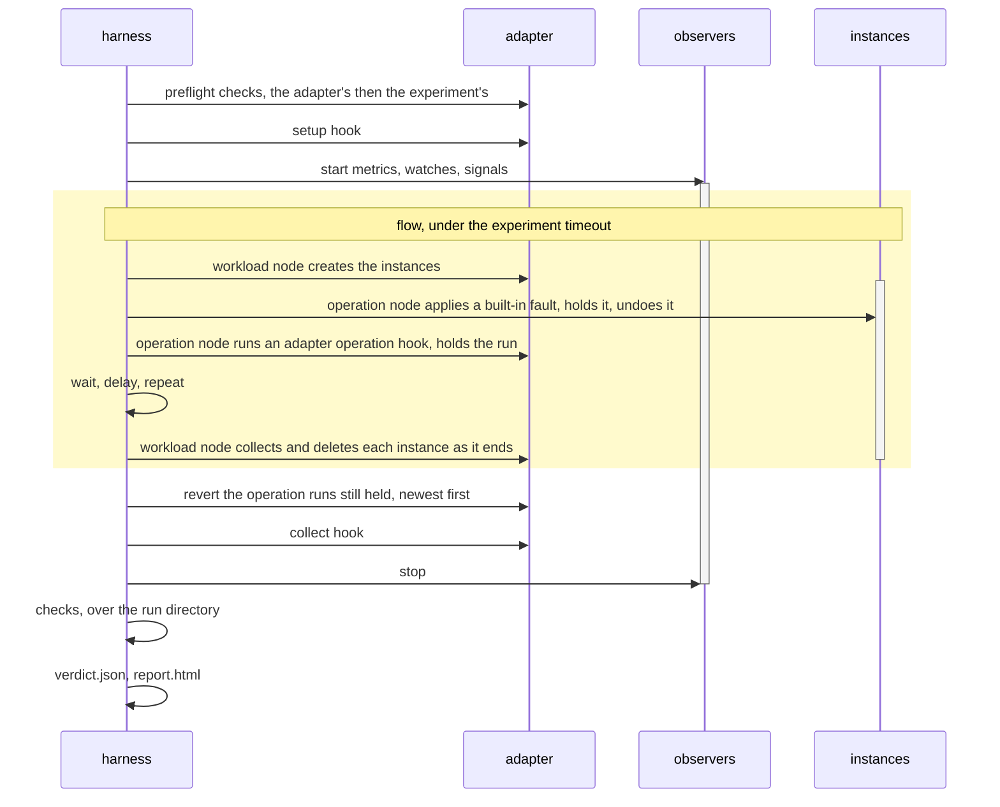

The observers run from before the flow until after the collect hook, so the
metrics, watches and signals cover the faults and the recovery. A workload
node runs for as long as its instances do: it creates them through the
adapter, polls their state, and collects and deletes each one as it ends.
Operation nodes, waits, delays and repeats run while it does. A built-in fault
is applied and, if it has a duration, undone within its node. An adapter
operation's runs are held until the end of the flow, when the harness reverts
them, newest first.

A failed preflight check skips the flow and ends the run with `ERROR`. An
error during the flow, or the first `SIGINT` or `SIGTERM`, aborts it: the
harness reverts faults, restarts a process target that is down, such as the
gateway, collects and deletes the instances, and still runs the checks, so the
run directory is complete and the verdict is `ERROR`. Send the signal to the harness pid, not
Ctrl-C to the wrapper, so the wrapper does not tear the gateway down first.
[Signals](REFERENCE.md#signals) has the details.

The experiment names an adapter and the roles the adapter defines. The
adapter maps each role to a container, a process or a pod, and the harness
onto one system on one backend:

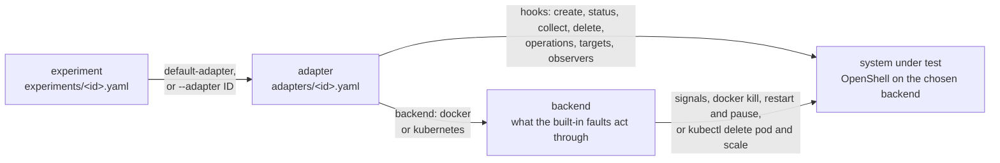

An experiment runs on its `default-adapter` unless `--adapter ID` names
another. It can run on any adapter that has the options, operations, signals,
targets and roles it uses, on a backend that supports its faults. An adapter
that lacks one of those cannot run the experiment, which is then not
applicable there: `run` and `preflight` report `n/a on <adapter>` with every
gap and exit 0 without running, and `chaos validate --adapter ID` reports the
same with no gateway and no backend, so it tells you before anything runs
whether an experiment can run on an adapter. On the experiment's own
`default-adapter`, not applicable is invalid. [Adapters](#adapters) says
more.

## Read the result

An experiment run is the input to everything that comes after it. Three
commands turn it into something to look at, each shaped by what the
experiment does:

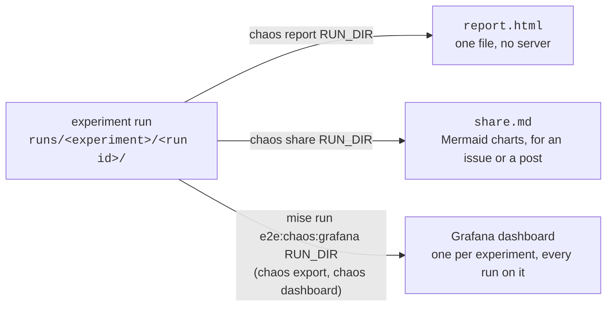

<table>
  <tr>
    <th><code>report.html</code></th>
    <th><code>share.md</code></th>
    <th>Grafana dashboard</th>
  </tr>
  <tr>
    <td><a href="images/report-gateway-kill-keeps-state.png">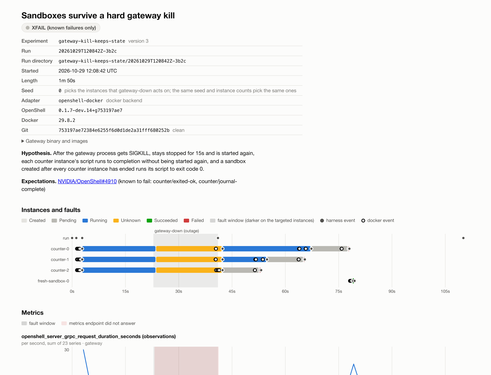</a></td>
    <td><a href="images/share-gateway-kill-keeps-state.png">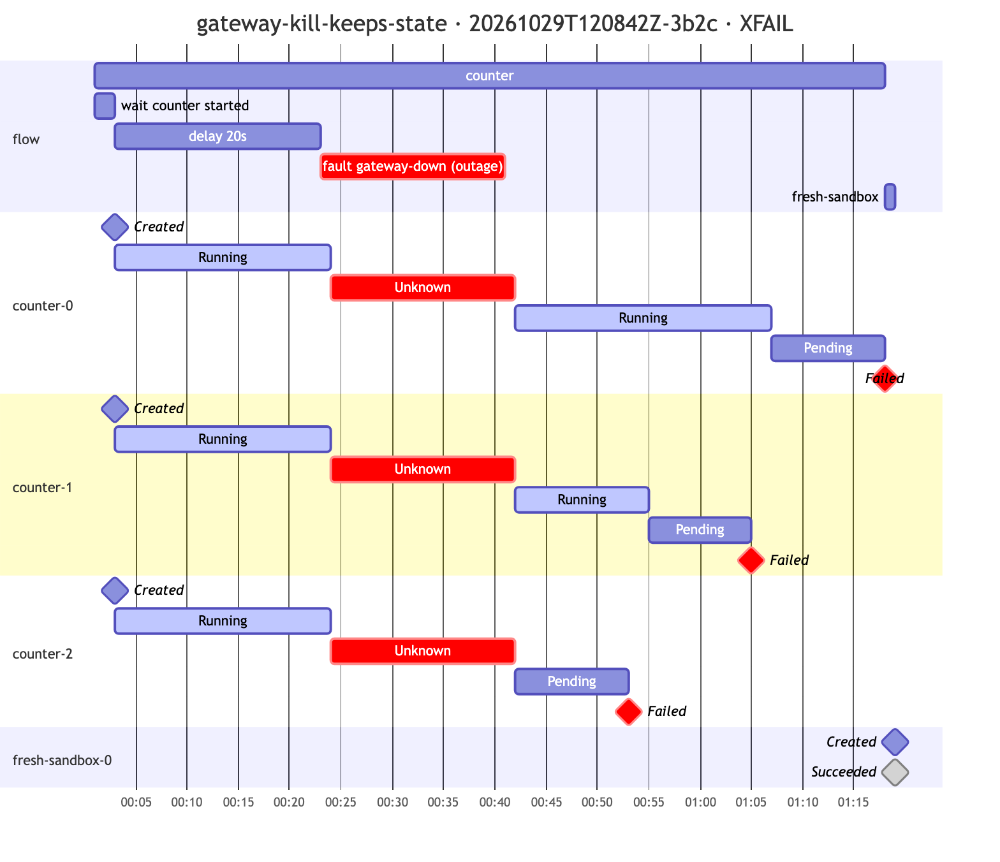</a></td>
    <td><a href="images/grafana-gateway-kill-keeps-state.png">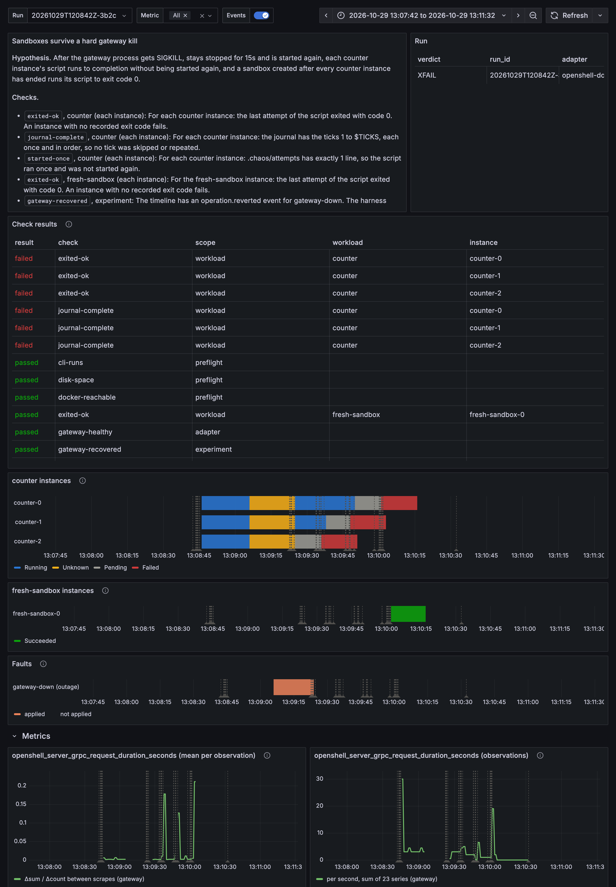</a></td>
  </tr>
  <tr>
    <td>the verdict, every check, one lane per instance, every metric chart and every event</td>
    <td>the verdict, the failed checks, the flow over the instance states and the metrics the experiment lists</td>
    <td>the experiment's view of any run, with PromQL over its metrics</td>
  </tr>
</table>

All three are from one `gateway-kill-keeps-state` run, which kills the
gateway under three counter instances and then creates a fresh sandbox.

Start with `report.html` in the run directory. It needs no server and no
network. It shows the verdict, hypothesis and harness errors; one lane per
instance, colored by state, with operation windows, harness events and docker
events for that instance's containers; a chart per metric the experiment
lists in `metrics:`, in that order, each with its description, counters as
rates, and a second chart of the mean per observation for each histogram and
summary, on the same time axis, with the windows when the endpoint did not
answer shaded; every other metric family the run scraped, folded under
"Other metrics the run scraped", leaving out charts that stay at zero; and
every check result, failures first, with its description and output. Without
`metrics:` every chart is drawn.
`chaos run` writes it for every experiment, and `chaos report RUN_DIR` writes
it again.

The timeline, `timeline.jsonl`, is the story of the run, one JSON object per
line. The hello-world demo run's reads, with `ts` left out:

```text
{"t": 0.001, "event": "run.started", "experiment": "hello-world", "version": 1, "seed": 0, "adapter": "openshell-docker"}
{"t": 1.157, "event": "node.started", "node": "flow", "name": "hello"}
{"t": 2.237, "event": "instance.created", "workload": "hello", "instance": "hello-0", "system_id": "0c64c26a-1d99-4416-8b2d-c85a8120f04f"}
{"t": 2.29, "event": "instance.state", "workload": "hello", "instance": "hello-0", "state": "Succeeded", "reason": "MainProcessCompleted"}
{"t": 2.616, "event": "instance.collected", "workload": "hello", "instance": "hello-0", "exit_code": 0}
{"t": 2.831, "event": "instance.deleted", "workload": "hello", "instance": "hello-0"}
{"t": 2.831, "event": "node.finished", "node": "flow", "name": "hello"}
{"t": 33.173, "event": "check.started", "scope": "workload", "instance": "hello-0", "check": "exited-ok"}
{"t": 33.174, "event": "check.finished", "scope": "workload", "instance": "hello-0", "check": "exited-ok", "ok": true}
{"t": 33.174, "event": "check.started", "scope": "workload", "instance": "hello-0", "check": "said-hello"}
{"t": 33.193, "event": "check.finished", "scope": "workload", "instance": "hello-0", "check": "said-hello", "ok": true}
{"t": 33.194, "event": "check.started", "scope": "adapter", "instance": null, "check": "no-leaked-containers"}
{"t": 33.253, "event": "check.finished", "scope": "adapter", "instance": null, "check": "no-leaked-containers", "ok": true}
{"t": 33.253, "event": "check.started", "scope": "adapter", "instance": null, "check": "nothing-paused"}
{"t": 33.291, "event": "check.finished", "scope": "adapter", "instance": null, "check": "nothing-paused", "ok": true}
{"t": 33.291, "event": "check.started", "scope": "adapter", "instance": null, "check": "gateway-healthy"}
{"t": 33.332, "event": "check.finished", "scope": "adapter", "instance": null, "check": "gateway-healthy", "ok": true}
{"t": 33.333, "event": "run.finished", "verdict": "PASS"}
```

[Run directory](REFERENCE.md#run-directory) lists every file and
[Timeline events](REFERENCE.md#timeline-events) every event.

### The verdict

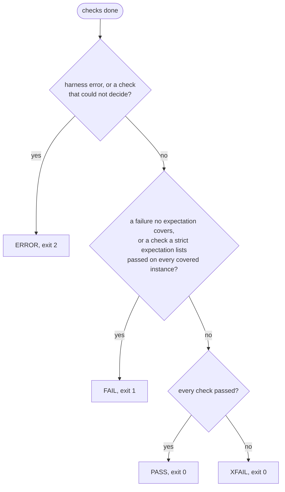

`ERROR` means the harness could not do what the experiment says, such as a
failed preflight check or hook; it says nothing about OpenShell. `XFAIL`
means the known bugs are still there and nothing else broke. An `XPASS` line
means a check that an expectation lists passed: the bug may be fixed.
[Verdict](REFERENCE.md#verdict) has the table.

### Share a run

`chaos share RUN_DIR` writes `share.md` next to `report.html`: one Markdown
page to paste into an issue comment, a discussion or a post. It holds the
verdict and the failed checks; a Mermaid gantt of the flow, with the
workloads, waits, delays, operations and faults over one section per
instance, one row per state, in the colors `report.html` uses: green
running or succeeded, amber pending, red unknown or failed, with a diamond
where an instance was created or succeeded; and, for each metric the
experiment lists in
`metrics:`, its check results in a table and a Mermaid line chart, the first
two open and the rest folded. GitHub draws Mermaid in issues, pull requests
and discussions. For places that do not, `--png` also renders every chart
with mermaid-cli (`npm install -g @mermaid-js/mermaid-cli`) into `share/`
next to the page; the `share.md` column above is that rendering of the
gantt. `mise run e2e:chaos:share RUN_DIR` runs it from the repository root.

The gantt stays readable on a long run: a node that repeats more than three
times, such as `restart` in `sandbox-stop-start`, becomes one row,
`restart ×20`; and past 40 rows the remaining instance sections are left
out, failed instances kept first, with a note pointing at `report.html`.

### Grafana

To see a run on the experiment's own dashboard, or query its metrics with
PromQL, load it into a local Prometheus and Grafana:

```shell
mise run e2e:chaos:grafana e2e/chaos/runs/hello-world/<run-id>
```

The task exports the run with `chaos export`, replaces the data loaded
before, starts the containers in `grafana/compose.yaml` and prints the
dashboard link. Grafana listens on `127.0.0.1:3030` without login;
`CHAOS_GRAFANA_PORT` changes the port.

The Grafana column above is the same `gateway-kill-keeps-state` run as the
report. `chaos dashboard` generates the dashboard from the experiment
manifest, so it shows what the experiment is about: the hypothesis and what
each check tests, the run's check results, one instance-state timeline per
workload, the operations, the timeline events as annotations, and the
metrics the experiment lists in `metrics:`, each a metric family name,
drawn as in the report, or `{title, expr, description}` with raw PromQL,
which only the dashboard draws. Without `metrics:` the dashboard has every
chart of the run. To replace the generated dashboard, write `grafana/dashboards/<id>.json` with its uid, `exp-<id>`,
shortened with a hash suffix when longer than 40 characters. Several run
directories on one command line load together, the generated `chaos_*`
series labeled with `run_id` and the scraped ones with `chaos_run_id`, so the
same dashboard can compare runs of one experiment. To stop
the containers and delete the data:

```shell
mise run e2e:chaos:grafana --down
```

## Write an experiment

### Add an operation that restarts one sandbox container

[`experiments/sandbox-container-restart.yaml`](experiments/sandbox-container-restart.yaml)
asks whether a sandbox comes back after its container is restarted in place,
and whether the script in it finishes. It adds four ideas to the hello world.

A workload that can tell it was interrupted. The counter script appends one
line per tick to a journal and saves its position, so a restarted script
continues where it stopped. A gap in the journal means lost work:

```yaml
workloads:
  - name: counter
    description: >
      Counts from 1 to $TICKS, one tick every $INTERVAL seconds. Each tick
      appends the line "<tick> <unix time>" to the instance's journal, then
      saves the tick number atomically. If the script is started again in the
      same output directory, it continues from the saved tick plus one.
    kind: shell
    instances: 2
    env: {TICKS: "60", INTERVAL: "1"}
    options: {restart-policy: on-failure}   # an adapter option, passed to openshell
    run: |
      out=$CHAOS_EXPERIMENT_WORKLOAD_INSTANCE_OUTPUT_DIR
      start=$(cat "$out/counter" 2>/dev/null || echo 0)
      for i in $(seq $((start + 1)) "$TICKS"); do
        echo "$i $(date +%s)" >> "$out/journal"
        echo "$i" > "$out/counter.tmp" && mv "$out/counter.tmp" "$out/counter"
        sleep "$INTERVAL"
      done
```

An operation, and a flow that times it. The operation uses the built-in
`restart-in-place` fault on the sandbox container of one instance, selected
by a generator seeded with `--seed`; on Docker that is `docker restart`. The
flow runs the workload and, beside
it, waits until both instances have started, waits 10s more, and applies the
operation:

```yaml
operations:
  - name: restart-sandbox
    description: >
      Restarts the sandbox container of one counter instance in place,
      picked as the experiment description says.
    uses: restart-in-place                  # docker restart on this adapter
    target: {workload: counter, role: sandbox}
    select: {count: 1}                      # one of the two instances

flow:
  parallel:
    - counter
    - serial:
        - {wait: {workload: counter, condition: started}}
        - {delay: 10s}
        - restart-sandbox
```

A control. Only one of the two instances is restarted. If the other one
passes and the restarted one fails, the restart caused the failure, not the
environment.

A known bug. OpenShell has an open issue for this failure. The experiment
names it in `expectations`, and `instances: affected` limits it to the
instance that the operation selected, so the control must still pass:

```yaml
expectations:
  - issue: NVIDIA/OpenShell#4828
    checks: [counter/exited-ok, counter/journal-complete, counter/back-to-running]
    instances: affected
```

A run that set the operation's `target.role` to `supervisor` with
`--set operations.restart-sandbox.target.role=supervisor` restarted the
supervisor container of the selected instance instead of its sandbox
container. Its `manifest.json` records the override in `overrides`. Its
timeline, in minutes and seconds since the start:

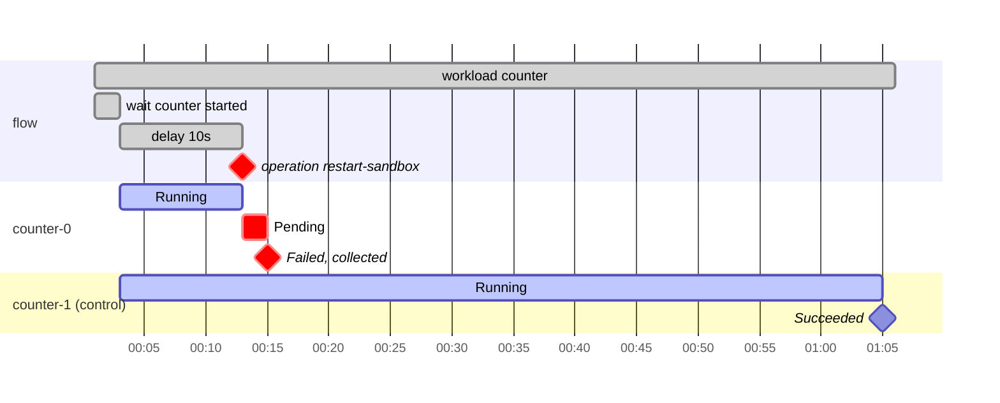

The operation selected `counter-0`. Its sandbox went to `Pending`, then
`Failed`, and never ran again. `counter-1` counted to 60. The workload lines
of the verdict, where `journal-complete` shows the last lines of its output,
a diff of the ticks missing from the journal:

```text
  xfail counter-0/exited-ok (known: NVIDIA/OpenShell#4828)
          no exit code recorded
  xfail counter-0/journal-complete (known: NVIDIA/OpenShell#4828)
          < 12
          < 13
          < 14
          < 15
          want each tick from 1 to 60 at least once
  xfail counter-0/back-to-running (known: NVIDIA/OpenShell#4828)
          counter-0 was not Running after the restart
  ok    counter-1/exited-ok
  ok    counter-1/journal-complete
  ok    counter-1/back-to-running
```

When the fix lands, the `counter-0` checks pass and the run turns `FAIL` with
`XPASS`. Then empty the expectation's `checks` and increase `version`: the
experiment becomes a regression test for the fixed bug.

The other experiments in `experiments/` build on the same pieces;
[The experiments](#the-experiments) lists them.

### Change the system with data and adapter operations

Not every operation is a fault. An adapter operation runs a hook of the
adapter, such as a new policy, and the adapter's `revert` hook puts it back at
the end of the flow.
[`experiments/policy-tighten-survives-gateway-restart.yaml`](experiments/policy-tighten-survives-gateway-restart.yaml)
passes the policies as `data` and sets one with the adapter's `openshell-policy-set`
operation:

```yaml
data:
  tight: {version: 1, network_policies: {...}}
workloads:
  - name: fetcher
    description: >
      For $SECONDS_TO_RUN seconds, about once a second, opens a TCP connection to
      $ALLOWED:443 and to $DENIED:443 with a 1s timeout. Each attempt appends
      the line "<unix time> <host> <errno>" to the instance's journal, where
      errno is 0 on success and -1 on a timeout.
    options: {policy: open}
operations:
  - name: tighten
    description: Sets policy tight on every fetcher instance.
    uses: openshell-policy-set
    options: {policy: tight}
    target: {workload: fetcher}
    select: all
flow:
  parallel:
    - fetcher
    - serial:
        - {wait: {workload: fetcher, condition: started}}
        - {delay: 10s}
        - tighten
```

The harness writes each `data` entry to `data/<name>` in the run directory
and passes its path to the hook. [ADAPTER.md](ADAPTER.md#openshell-docker)
describes `openshell-policy-set` and `openshell-sandbox-restart`.

### Measure performance without faults

An experiment can run load and decide the verdict from the metrics. The
adapter scrapes the gateway's `/metrics` every 2s into
`system/metrics/gateway.jsonl`, one record per scrape. The experiment lists
the metrics it is about under `metrics:`, and a `metric` check holds one of
them to a threshold over the recorded scrapes:

```yaml
metrics:
  - family: openshell_server_mutation_lock_timeouts_total
    description: Sandbox mutations that timed out waiting for the lock.
  - openshell_server_mutation_lock_wait_seconds

checks:
  - name: no-lock-timeouts
    description: No mutation timed out waiting for the sandbox lock.
    kind: metric
    metric: openshell_server_mutation_lock_timeouts_total
    value: increase
    at-most: 0
  - name: lock-waits-under-50ms-total
    description: All waits for the sandbox mutation lock add up to under 50ms.
    kind: metric
    metric: openshell_server_mutation_lock_wait_seconds_sum
    labels: {scope: sandbox}
    at-most: 0.05
```

`value` is the `last` scrape, the `min`, the `max`, or the `increase` from
the first scrape to the last; `labels` picks the series. Before the run, the
`metrics-exported` preflight check scrapes the sources once and fails when a
listed family is not exported, so a typo ends the run before anything is
created. A ratio, or anything else the kind does not express, is a `shell`
check with `jq` over the same file.

Raise the load from the command line, without editing the manifest:

```shell
mise run e2e:chaos e2e/chaos/experiments/smoke.yaml --set workloads.counter.instances=50
```

The report and the Grafana dashboard chart the same metrics, so a threshold
that fails comes with the curve that crossed it.

### Add an experiment

1. Copy an experiment in `experiments/` to `experiments/<id>.yaml` and set
   `id` to the same name.
2. Write the hypothesis and descriptions as
   [Writing descriptions](#writing-descriptions) says.
3. Validate it:

   ```shell
   uv run --project e2e/chaos chaos validate e2e/chaos/experiments/<id>.yaml
   ```

4. Run it under the e2e wrapper and read `report.html`. Run it twice with the
   same `--seed` to confirm the operations select the same instances.

Checks and hooks run as bash on the host with your permissions. Review an
experiment as you would review code before you run it.

[Experiment](REFERENCE.md#experiment) lists every field, flow node, operation
and variable.

### Writing descriptions

- Start a workload check description with `For each <workload> instance:` so
  it is clear that the check runs once per instance.
- Say when a check measures something, for example "when the adapter's
  collect runs", not "at the end of the run".
- Count delays from a named event, for example "10s after every counter
  instance has been observed started", not "10s after they start".
- Write a hypothesis that the checks can decide. "Works normally" cannot be
  checked; "the last attempt exited with code 0" can.
- State whether the checks encode desired or current behaviour.

### Start with shell kinds

Almost every workload and check is `kind: shell`, and every adapter hook is
a bash script.
A shell script can express any workload or check, so the harness ships with
few kinds and a new experiment never waits for a new one.

When the same script shows up in several experiments, with a meaning that
one phrase names, it can become a kind of its own: a typed check that the
validator checks, that names its failure precisely, and that the report can
draw. `exit-code` is the first one. It replaces the shell check
`[ "$CHAOS_EXPERIMENT_WORKLOAD_INSTANCE_EXIT_CODE" -eq 0 ]`, and reports a
missing exit code as such instead of as a shell error. `metric` is the
second: a bound on a recorded metric, which replaces `jq` over
`system/metrics/*.jsonl`, can only name a metric the experiment lists, and
is checked against the scraped endpoint before the run. Candidates the
current experiments already repeat:

| Pattern today (`kind: shell`) | Where | Possible kind |
|---|---|---|
| `diff <(seq 1 "$TICKS") <(cut -d" " -f1 journal ...)` | every counter experiment | `sequence`: a file holds 1 to N, each once in order, or each at least once |
| `wc -l < .chaos/attempts` compared with a number | `gateway-kill-keeps-state`, `gateway-graceful-restart`, `supervisor-pause` | `attempts`: the script started exactly, or at least, N times |
| `jq` over `timeline.jsonl` for state changes after an operation | `sandbox-container-restart` | `instance-state`: after an operation, the instance returns to a state |
| `grep` over an operation log for each outcome | `sandbox-stop-start` | `operation-log`: count each outcome of an operation |

Kinds for workloads and operations follow the same rule: an `http` workload that
runs a load generator and records its summary, or network faults that Chaos
Mesh applies on Kubernetes and a proxy applies on Docker. Each new kind keeps
its shell equivalent possible, so an experiment that needs something slightly
different writes the shell script and does not wait.

## The experiments

| Experiment | Title | Operations | Expectation |
|---|---|---|---|
| `hello-world` | A sandbox says hello. | none | |
| `smoke` | Counters run to completion with no faults. | none | |
| `supervisor-kill` | A sandbox survives its supervisor being killed. | `kill` | |
| `supervisor-pause` | A workload runs to completion while its supervisor is frozen. | `freeze` | |
| `sandbox-container-restart` | A sandbox returns to Ready after its container restarts. | `restart-in-place` | NVIDIA/OpenShell#4828 |
| `gateway-graceful-restart` | Counter instances resume after a graceful gateway restart. | `restart` | |
| `gateway-kill-keeps-state` | Sandboxes survive a hard gateway kill. | `outage` | NVIDIA/OpenShell#4910 |
| `policy-tighten-survives-gateway-restart` | A tightened policy stays in effect across a gateway restart. | `openshell-policy-set`, `outage` | NVIDIA/OpenShell#4910 |
| `sandbox-stop-start` | A stopped sandbox starts again every time. | `openshell-sandbox-restart` | NVIDIA/OpenShell#4981, flaky |

`chaos list` prints each experiment's id, version, title and issues, and
`chaos show ID` describes one.
[Demo](#demo) runs `hello-world` and [Write an
experiment](#write-an-experiment) builds `sandbox-container-restart`. Four
more follow, each as the part of its manifest that shapes the run, with the
`description` fields left out, and a chart of one run on `openshell-docker`,
drawn from the run's `timeline.jsonl` in minutes and seconds since
`run.started`. Only the `sandbox-stop-start` run is of an older version of
its experiment, and its entry says how it differs. In the `flow` section
every bar is a flow node, named by its kind: the workload node spans from
creating its instances to the last one ending, a `wait` or `delay` node
spans until it ends, and an operation node marks the moment a fault applied
or spans the time it was held. Each other section is one instance, with the
states the adapter's `status` hook reported, and `collected` where the
harness copied its output out.

### supervisor-kill

```yaml
operations:
  - name: kill-supervisors
    uses: kill
    target: {workload: counter, role: supervisor}
    select: {count: 2}

flow:
  parallel:
    - counter
    - serial: [{wait: {workload: counter, condition: started}}, {delay: 10s}, kill-supervisors]
```

The built-in `kill` fault kills the supervisors of two of the three counters
without warning, and the harness does not restart them. The run failed:

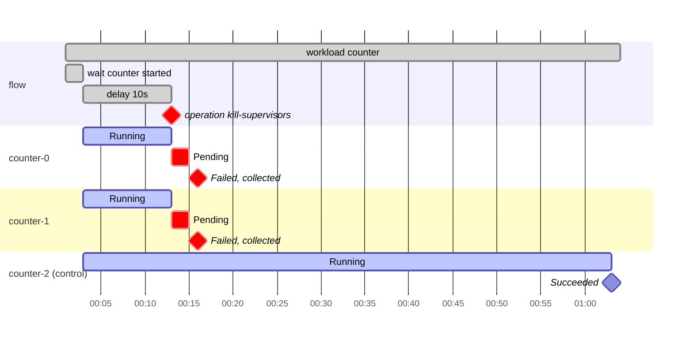

The two selected sandboxes went to `Pending` and then `Failed` within three
seconds of the kill. The verdict reports `exited-ok` with
`no exit code recorded` and `journal-complete` with ticks 12 to 60 missing
for both. The control counter finished, and the workload node ended with
it.

### gateway-graceful-restart

```yaml
operations:
  - name: gateway-restart
    uses: restart
    target: gateway
    select: one
    grace-period: 60s

flow:
  parallel:
    - counter
    - serial: [{wait: {workload: counter, condition: started}}, {delay: 15s}, gateway-restart]
```

The built-in `restart` fault sends `SIGTERM` to the gateway process, waits up
to the grace period for it to exit, then runs the adapter's `start` hook,
which waits for `/healthz`. The run passed:

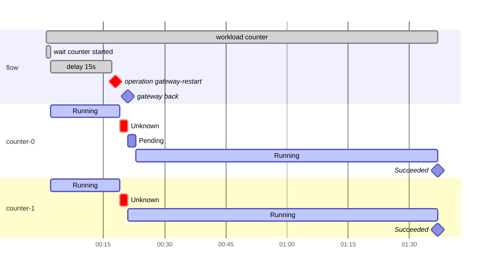

While the gateway was down the `status` hook could not reach it, so both
instances show `Unknown`. Once it was back, `counter-0` went through
`Pending` for two seconds and `counter-1` reported `Running` at once; both
counted to the end.

### policy-tighten-survives-gateway-restart

```yaml
expectations:
  - issue: NVIDIA/OpenShell#4910
    checks: [fetcher/exited-ok, fetcher/denied-only-after-tighten]

operations:
  - name: tighten
    uses: openshell-policy-set
    options: {policy: tight}
    target: {workload: fetcher}
    select: all

  - name: gateway-down
    uses: outage
    target: gateway
    select: one
    duration: 10s

flow:
  parallel:
    - fetcher
    - serial:
        - wait: {workload: fetcher, condition: started}
        - delay: 10s
        - tighten
        - delay: 10s
        - gateway-down
```

The adapter operation `openshell-policy-set` applies the `tight` policy from the
experiment's `data` to the running `fetcher` sandbox, then the built-in
`outage` fault kills the gateway and holds it down for ten seconds. The run
ended `XFAIL`:

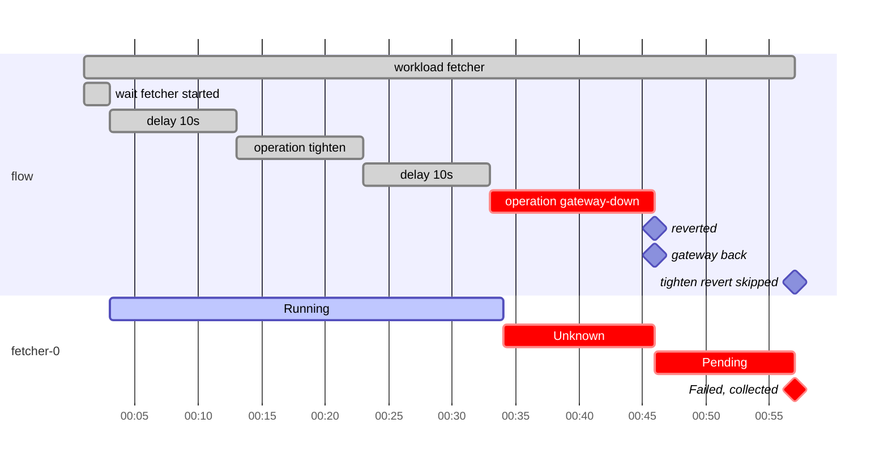

The policy change took ten seconds because the operation waits until the
sandbox reports the policy loaded. The outage lasted 13 seconds, not 10,
because it ends when the `start` hook returns. The sandbox did not survive the
restart, so `exited-ok` and `denied-only-after-tighten` failed as the
expectation says; the second reports `only 0 attempts after recovery`. The
`tighten` operation stayed on the undo stack until the flow ended, and its
revert was skipped because `fetcher-0` was deleted by then; the timeline
records that as `operation.reverted` with `skipped`.

### sandbox-stop-start

```yaml
expectations:
  - issue: NVIDIA/OpenShell#4981
    checks: [counter/starts-ready]
    kind: flaky

operations:
  - name: restart
    uses: openshell-sandbox-restart
    target: {workload: counter}
    select: all
    options: {jitter: "4"}

flow:
  parallel:
    - counter
    - serial:
        - wait: {workload: counter, condition: started}
        - repeat:
            for: 20m
            serial:
              - wait: {signal: reconcile-sweep, delay: 57500ms, timeout: 3m}
              - restart
```

The adapter operation `openshell-sandbox-restart` stops and starts the sandbox of every
counter instance, in parallel with a random jitter, and a `repeat` node runs
it after each reconcile sweep of the gateway. `reconcile-sweep` is a signal
of `openshell-docker`: a pattern on the lines of its `otel` watch, an
OpenTelemetry collector that prints the gateway's trace spans, matching the
end of each `reconcile.sandboxes` span. The gateway starts the next sweep
about 60 seconds after one ends, so the wait returns 57.5 seconds after a
sweep and the restarts, each after a random 0 to 4 seconds, land around the
next one. A sweep that lands between a start committing `Starting` and the
driver starting the sandbox sees the old, exited one, which is the bug the
experiment reproduces. The run charted is of version
1, whose flow waited ten seconds and then repeated the restart for ten
minutes with no wait between, so it restarted the sandboxes back to back,
119 times. It ended `XFAIL`. The chart shows the one instance of eight that did
not come back:

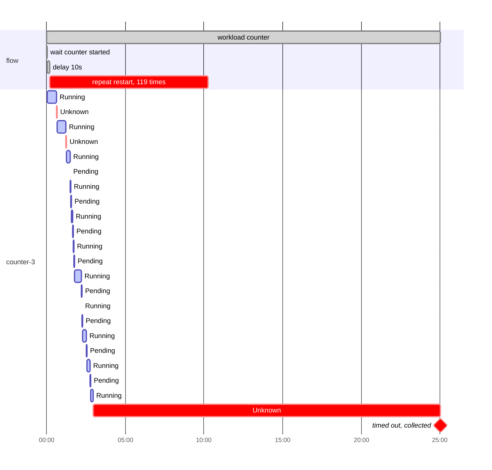

The other seven instances cycled through `Running`, `Pending` and `Unknown`
for the whole ten minutes and all reached `Succeeded` between 10:30 and 10:55.
`counter-3` stayed `Unknown` from 02:57 until its workload timeout at 25:02,
which is when the workload node ended: the sweep wrote
`Error (ContainerExited)` during a start and the start failed even though the
new supervisor connected.

## Adapters

An adapter is the only place that knows the system. It gives the harness:

- Instance hooks to create a sandbox, read its state, collect its files and
  delete it.
- Targets for the built-in faults: the gateway, as a process on
  `openshell-docker` and as a workload on `openshell-kubernetes`, and the
  sandbox and supervisor of each instance, as containers or pods.
- Operations of its own: `openshell-policy-set` and `openshell-sandbox-restart` on OpenShell.
- Observers and signals: the gateway's metrics on both adapters; `docker
  events`, the gateway's trace spans and the `reconcile-sweep` signal, which
  a flow can wait for, on `openshell-docker`; the cluster's events on
  `openshell-kubernetes`. They feed the report's charts and the Grafana
  dashboards.
- Preflight and adapter checks that run for every experiment.
- What it cannot do: `unavailable` names the built-in faults the backend
  cannot provide and says why.

To see which experiments each adapter can run, without Docker, a cluster or a
gateway:

```shell
uv run --project e2e/chaos chaos validate --all-adapters
```

```text
experiment                               openshell-docker  openshell-kubernetes
gateway-graceful-restart                 ok                ok
gateway-kill-keeps-state                 ok                ok
hello-world                              ok                ok
policy-tighten-survives-gateway-restart  ok                ok
sandbox-container-restart                ok                n/a
sandbox-stop-start                       ok                n/a
smoke                                    ok                ok
supervisor-kill                          ok                ok
supervisor-pause                         ok                n/a

sandbox-container-restart on openshell-kubernetes: n/a: operations.restart-sandbox: restart-in-place on a pod target (role sandbox) is not supported on kubernetes: the Kubernetes driver runs sandbox pods with restartPolicy: Never, so a container is never restarted in place; this failure does not happen on this adapter
sandbox-stop-start on openshell-kubernetes: n/a: flow.parallel[1].serial[1].repeat.serial[0].wait: openshell-kubernetes has no signal 'reconcile-sweep'
supervisor-pause on openshell-kubernetes: n/a: operations.pause-supervisors: freeze on a pod target (role supervisor) is not supported on kubernetes: freezing a pod's processes needs node-level cgroup access through a privileged pod, which this adapter does not have
```

`chaos validate --adapter <id> FILE...` checks the given files on one
adapter and prints `ok on`, `n/a on` or `invalid on` per file with every gap.
To run an experiment on the Kubernetes adapter, the e2e wrapper installs the
chart into the cluster that `OPENSHELL_E2E_KUBE_CONTEXT` names, or into a
local k3d cluster when it is unset, and `scripts/kubernetes-env.sh` derives
the variables the adapter requires:

```shell
OPENSHELL_E2E_KUBE_CONTEXT=kind-openshell-chaos e2e/with-kube-gateway.sh e2e/chaos/scripts/kubernetes-env.sh uv run --project e2e/chaos chaos run --adapter openshell-kubernetes e2e/chaos/experiments/gateway-graceful-restart.yaml
```

The Kubernetes adapter has not been run against a cluster yet. It loads,
every experiment validates against it, and its scripts pass `shellcheck`,
but no run directory from it exists; expect to fix it on first use.
Neither adapter creates its cluster or gateway; the wrappers do, and
[Provisioning](ADAPTER.md#provisioning) says how that would move into the
adapter.

[ADAPTER.md](ADAPTER.md) has the hook contract, both adapters, and how to
write an adapter. Every hook and check runs on the machine that runs `chaos`,
and only the workload's `run` script runs in the sandbox; see
[Where things run](ADAPTER.md#where-things-run).

## Develop the harness

```shell
e2e/chaos/scripts/test-and-lint.sh
```

It runs the unit tests, `ruff check`, `ruff format --check`, and
`shellcheck`, and prints the steps that failed. Arguments go to `pytest`, for
example `-k evaluate`. It needs no Docker and no gateway.

The one end-to-end check is `mise run e2e:chaos:check`: it builds and starts
a Docker-backed gateway, runs `hello-world` and then `smoke` against it, and
fails unless both verdicts are `PASS`. It is not in CI; run it before
posting a change to the engine or the Docker adapter.

`shellcheck` checks every script embedded in YAML, not only the files in
`scripts/`. `scripts/shellcheck-embedded-scripts.py` writes each script from
`adapters/` and `experiments/` to its own file, with the shell it runs under
(bash for hooks and checks, with the adapter `prelude` before each hook;
POSIX `sh` for workload `run` scripts), and runs `shellcheck` on them. A
finding names the YAML file and the script's path in it, for example
`openshell-docker.yaml/instance.create.bash:12`; in a hook, the line number
counts the prelude lines before the hook. Install `shellcheck` first, for
example with `brew install shellcheck`.

`tests/fixtures/invalid-*.yaml` holds one rejected experiment per validation
rule. `tests/test_envvars.py` checks the
[environment variable table](REFERENCE.md#environment-variables) against the
code.

To try something by hand against a gateway, start a shell under the wrapper:

```shell
e2e/with-docker-gateway.sh bash
```

### What a Rust engine would reuse

The repository's E2E suites in `tests/` already bring up a gateway and talk
to it through the SDK, and this harness drives the same gateway through the
CLI from adapter hooks. An engine written on the testkit would keep the
experiment files and replace the hooks: the testkit's gateway bring-up and
SDK client would implement the instance hooks (`create`, `status`,
`collect`, `delete`) directly, the Docker conformance scenarios would serve
as workloads, and `#[testkit::test]` would be the runner of a compiled
experiment, with the flow and the checks evaluated in the test body.

The run directory contract is the part to keep unchanged: `manifest.json`,
`timeline.jsonl`, the instance directories, `verdict.json` and
`index.jsonl` as [REFERENCE.md](REFERENCE.md#run-directory) describes
them. An engine that writes those files keeps `chaos report`,
`chaos evaluate`, `chaos export` and `chaos dashboard` working as they are,
so the reports and the Grafana dashboards need no port.

## Documentation

- [REFERENCE.md](REFERENCE.md): every experiment field, operation, flow node,
  environment variable, run directory file, timeline event and command.
- [ADAPTER.md](ADAPTER.md): the adapter format, the hook contract, and the
  `openshell-docker` and `openshell-kubernetes` adapters.

### Terms

| Term | Meaning |
|---|---|
| run | One execution of one experiment, with one run id and one run directory. |
| experiment | What one experiment manifest describes: workloads, operations, a flow and checks, run and judged as one unit. |
| experiment manifest | The YAML file that describes one experiment, `experiments/<id>.yaml`. |
| system | The system under test: what creates and runs the instances, and what the operations change. On the OpenShell adapters it is the gateway with its Docker daemon or cluster, and the sandboxes and supervisors they run. The harness never touches it except through the adapter. |
| adapter | What binds the harness to one system on one backend: the hooks, operations, targets and signals one adapter manifest describes. |
| adapter manifest | The YAML file that describes one adapter, `adapters/<id>.yaml`. |
| backend | What the built-in faults act through: `docker` or `kubernetes`. |
| workload | A named script and its settings. It describes instances; it does not run by itself. |
| instance | One copy of a workload's script that the system runs, created by the adapter's `create` hook; on OpenShell, one sandbox. A workload with `instances: 3` has the instances `<workload>-0`, `<workload>-1` and `<workload>-2`. |
| attempt | One start of the script in an instance. The system can start it again, for example after a gateway restart. Each attempt adds a line to `.chaos/attempts`; `.chaos/exit_code` holds the exit code of the last attempt. |
| observed started | The instance `status` hook returned `Running`, `Succeeded` or `Failed` at least once. The harness polls, so a state can last less than one poll and not be observed. |
| ended | The instance reached `Succeeded` or `Failed`, or the workload `timeout` expired before it did. |
| node | One entry in the flow: a workload, an operation, `serial`, `parallel`, `delay`, `wait` or `repeat`. |
| operation | A named step in the flow that disrupts or changes the system. `uses` names a built-in fault or an adapter operation. |
| fault | A built-in operation that disrupts a target, named by its effect: `restart`, `outage`, `kill`, `restart-in-place` or `freeze`. The backend chooses the mechanism. Runs recorded under the former names, such as `container-kill`, still evaluate. |
| adapter operation | An operation that runs an adapter hook, such as `openshell-policy-set`. The adapter's `revert` hook puts it back at the end of the flow, or on abort. |
| target | What an operation acts on: an adapter target such as `gateway`, a workload's instances, or one role (such as `supervisor`) of a workload's instances. |
| applied | A fault is in effect: `operation.applied`. |
| completed | An operation has finished: `operation.completed`, with its outcome. An adapter operation completes when its hook returns, once the system reports the change in effect. |
| reverted | The harness has undone a fault held for a `duration`: `operation.reverted`. After `outage` the `start` hook has also returned, so for the gateway `/healthz` returned 200. After `freeze` on a process target the harness has sent SIGCONT, and no hook runs. |
| outcome | How an operation run ended: `ok`, `skipped` or `failed`. A `failed` outcome is data for the checks, not a harness error. |
| outage | The time from applying a fault to `operation.reverted`. For the `outage` fault it is longer than the `duration`, because it includes the `start` hook. |
| preflight | Checks that run before anything is created. A failed preflight check ends the run with `ERROR`. |
| expectation | A known bug the experiment reproduces: the issue and the checks it makes fail. |
| check scope | `workload`: the check runs once for each instance of that workload. `experiment`: once per run. `adapter`: an adapter check, once per run, for every experiment. `preflight`: an adapter or experiment preflight check. |
| adapter collect | The adapter's `collect` hook. It runs once after the flow and before the checks. The OpenShell adapters wait 30s before they inspect containers or pods. |

### Naming

Choose the explicit, unambiguous name over the short one. This applies to
fields, operations, timeline events, hooks, commands and environment
variables.

- Do not abbreviate or drop qualifiers to save characters. Write
  `CHAOS_EXPERIMENT_WORKLOAD_INSTANCE_NAME`, not `CHAOS_INSTANCE_NAME`, and
  `default-adapter`, not `adapter`.
- A name says what a thing does or belongs to, not how one backend does it:
  a fault is named by its effect, `restart-in-place` rather than `docker
  restart`, so it means the same on every backend, and an environment
  variable starts with the path of its entity.
- Keys are kebab-case, in experiments and adapters. Keys inside `data` and
  `env` are not the harness's and keep their own names.
- Use each term with the one meaning in [Terms](#terms). A new concept gets a
  new term in that table, not a second meaning for an old one.

### Related projects

Most chaos tools inject faults and leave the verdict to someone else. This
harness was reasoned out from what an experiment on OpenShell needs. One idea
came from Jepsen; the rest were arrived at independently, and some of them
turned out to match what other tools do. The facts below come from each
project's documentation and source in October 2026.

#### Chaos Mesh as a possible injector

Chaos Mesh (Apache-2.0, CNCF Incubating) injects faults into Kubernetes
through custom resources. The harness's `kubernetes` backend deletes and
scales with `kubectl` itself, which covers `restart`, `outage` and `kill`
and nothing else. A backend that handed
the faults to Chaos Mesh as `PodChaos` resources would keep the workloads,
flow and checks here.

The built-in faults map onto `PodChaos` where it has a counterpart:
`restart` onto `pod-kill` (with `grace-period`), `outage` onto `pod-failure`
(with `duration`), and `kill` onto `container-kill`. `select: one`, `all` and
`{count: N}` map onto its `mode` (`one`, `all`, `fixed` with `value`).
`restart-in-place` and `freeze` have no `PodChaos` action, so Chaos Mesh
would not add them on Kubernetes either.

Chaos Mesh decides no verdict. A `Workflow` orders faults with `Serial`,
`Parallel`, `Suspend`, `Task`, `StatusCheck` and `Schedule` templates. A
`StatusCheck` polls an HTTP endpoint and can abort the workflow, and
`Schedule` repeats on a cron. There is no counterpart to `repeat`, to a
`wait` until a workload has started, or to checks over recorded files.
Outside Kubernetes, Chaosd injects host faults (process, network, stress,
disk) but has no container faults, so on Docker the harness signals processes
and calls `docker` itself.

#### The idea we took from Jepsen

Jepsen: record a history, check it afterwards. A Jepsen test interleaves
client operations with nemesis faults, records every operation, and hands the
history to a checker (Knossos for linearizability, Elle for transactions).
Each run lands in `store/<test>/<date>/`. Here `timeline.jsonl` and the
per-instance files are the history, checks are the checkers, and
`runs/<run id>/` is the store. Jepsen tests are Clojure programs that SSH into
database nodes; these are YAML files with shell scripts that run in sandboxes.

#### Where the design coincides with other tools

Chaos Toolkit: a hypothesis, then a method. A Chaos Toolkit experiment
(`chaos run experiment.json`) has a `title`, a `description`, a
`steady-state-hypothesis` whose probes carry tolerances, a sequential
`method`, and `rollbacks`. Our `title`, `hypothesis`, `description` and
`flow` ended up with the same shape without starting from it: an experiment
needs a claim, the steps that test it, and a name. Its probes run live,
before and after the method, and their results go to `journal.json`. Our
checks run afterwards over the run directory, so `chaos evaluate` can decide
a finished run again with changed checks.

k6 and kube-burner: a threshold sets the exit code. A k6 threshold such as
`http_req_failed: ['rate<0.01']` makes a load test exit non-zero, and
kube-burner fails with exit code 1 on a PromQL alert of severity `error` or a
`podLatency` threshold. The performance experiments and the `metric` kind
work the same way, reached on their own: a measurement with a
limit is a check, and checks decide the verdict. k6's Kubernetes fault extension, xk6-disruptor, was
archived in June 2026.

#### Same goal, different approach

| Project | Runs against | An experiment is | Pass or fail | Why not here |
|---|---|---|---|---|
| LitmusChaos (Apache-2.0, CNCF Incubating) | Kubernetes | `ChaosEngine` resources in Argo Workflows | HTTP, command, Kubernetes and Prometheus probes, weighted into a resilience score | Needs a Kubernetes control plane; no Docker target |
| Krkn (Apache-2.0, CNCF Sandbox) | Kubernetes, OpenShift, cloud nodes | `config.yaml` that lists scenario files | Recovery time per scenario, Prometheus alert profiles, health checks; HTML and PDF reports | Kubernetes only; no workloads inside the system under test |
| Pumba (Apache-2.0) | Docker, containerd, Podman | CLI flags: `pumba kill`, `stop`, `pause`, `restart`, `netem` | None | Closest to our Docker faults, but no experiment manifest, flow or verdict; each of our faults is one `docker` call or signal |
| ChaosBlade (Apache-2.0, CNCF Sandbox) | Hosts, Docker, CRI, Kubernetes | `blade` CLI commands or custom resources | None documented | Spans Docker and Kubernetes, but injects faults only |
| Toxiproxy (MIT) | Any TCP service, through a proxy | JSON config or HTTP API calls | None; the calling test asserts | Network faults only; a candidate for network faults on Docker |
| AWS Fault Injection Service | AWS resources | Template with `actions`, `targets` and `startAfter` | Stop conditions: CloudWatch alarms that halt the run, a guardrail rather than a verdict | AWS only |
| Gremlin | Hosts, containers, Kubernetes, through an agent | Web app, API or CLI | Health checks halt a scenario; a reliability score | Commercial service |
| Netflix Chaos Monkey | Instances managed by Spinnaker | Spinnaker configuration | None | Terminates instances at random; needs Spinnaker; no release since January 2025 |

None of these combines one manifest with workloads, operations, a flow and
checks; a run directory that can be evaluated again offline; XFAIL for known
issues; and a Docker target. That combination is why this harness exists.
